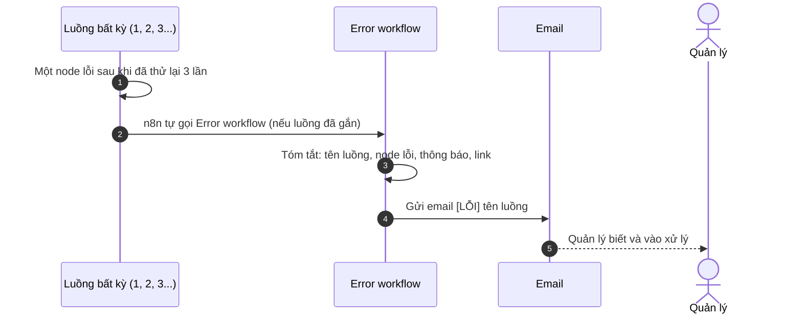

# Error workflow: giám sát lỗi

File n8n: `n8n-workflows/error-workflow.json` · Trigger: **Error Trigger** (tự chạy khi luồng khác lỗi)

## 1. Ngoài đời luồng này giải quyết việc gì?

Hệ thống chạy tự động thì sẽ có lúc hỏng (hết quota AI, email lỗi, DB mất kết nối). Nếu không ai biết, khách bị bỏ rơi mà không ai hay. Luồng này là **chuông báo cháy**: luồng nào lỗi thì quản lý nhận ngay một email nói rõ luồng nào, node nào, lỗi gì, kèm link mở lần chạy đó.

## 2. Sơ đồ swimlane

## 3. Từng bước

| Bước | Node | Làm gì |
|---|---|---|
| 1 | Error Trigger | Nhận thông tin lỗi từ n8n |
| 2 | Tóm tắt lỗi | Lấy tên luồng, node cuối cùng chạy, thông báo lỗi, link lần chạy |
| 3 | Email báo lỗi | Gửi cho `nhadn2457+quanly@gmail.com` (thử lại 3 lần) |

## 4. Nối với hệ thống

Mỗi luồng muốn được giám sát phải chọn "Error workflow" trong **Settings** của luồng đó. Tất cả các luồng (1, 1b, 2, 3, 4, 5) đều đã gắn.

## 5. Cách chạy thử

Tắt key Gemini hoặc đặt sai mật khẩu SMTP rồi gửi một đơn đăng ký: quản lý nhận email `[LỖI]`.
