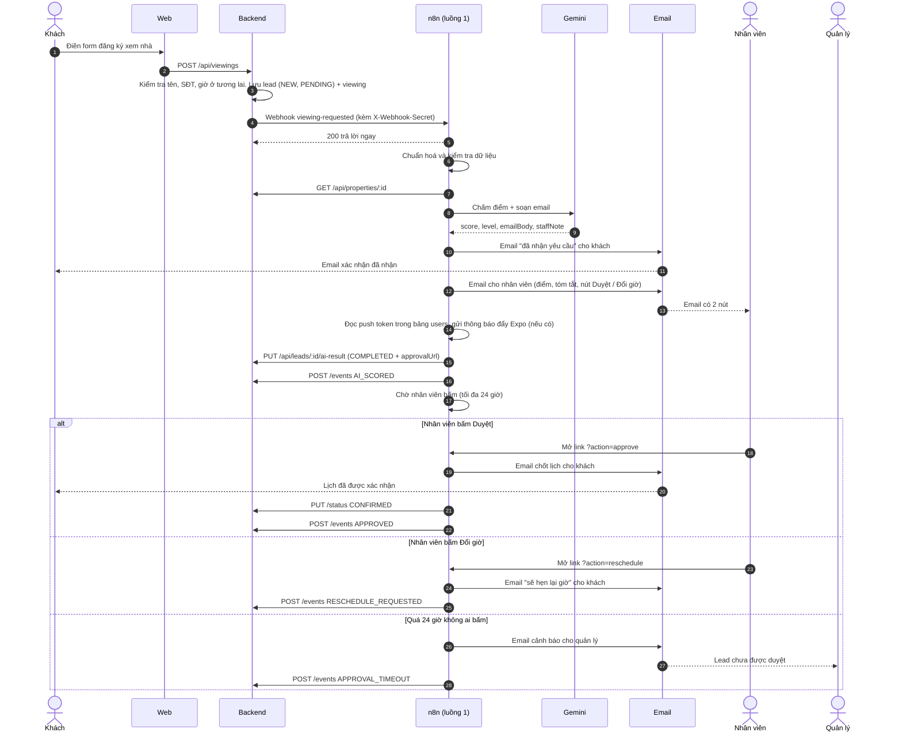

# Luồng 1: Tiếp nhận và chốt lịch xem nhà

File n8n: `n8n-workflows/luong-1-dat-lich.json` · Trigger: **Webhook** `POST /webhook/viewing-requested`

## 1. Ngoài đời luồng này giải quyết việc gì?

Khách vào web, chọn một căn nhà và đăng ký giờ xem. Ở văn phòng môi giới thật, nhân viên phải đọc từng đơn, đoán khách nào đáng gọi trước, gọi hỏi lại, rồi nhắn xác nhận lịch. Luồng này làm thay phần lặp lại:

- AI đọc đơn và **chấm điểm** khách: HOT (rất tiềm năng), WARM (trung bình), COLD (chưa rõ).
- Khách nhận ngay email "đã nhận yêu cầu".
- Nhân viên nhận email có điểm AI, tóm tắt và hai nút: **Duyệt** hoặc **Đổi giờ**. Nếu đã có app, nhân viên còn nhận thông báo đẩy.
- Chỉ khi nhân viên bấm Duyệt thì lịch mới được chốt và khách nhận email xác nhận. Đây là bước **người duyệt** (human-in-the-loop): AI không tự chốt lịch.

## 2. Ai tham gia?

| Làn | Là ai | Vai trò |
|---|---|---|
| Khách | Người mua nhà | Điền form trên web, nhận email |
| Web | Next.js | Gửi form lên backend |
| Backend | NestJS + PostgreSQL | Kiểm tra đầu vào, lưu khách, gọi n8n, nhận kết quả |
| n8n | Luồng này | Điều phối từng bước |
| Gemini | AI của Google | Chấm điểm, viết email |
| Email | Gmail SMTP | Gửi thư |
| Nhân viên | Sale | Bấm Duyệt / Đổi giờ |
| Quản lý | Chủ văn phòng | Nhận cảnh báo nếu nhân viên bỏ quên |

## 3. Sơ đồ swimlane

## 4. Từng bước

| Bước | Node n8n | Làm gì | Ghi vào DB |
|---|---|---|---|
| 1 | Webhook | Nhận đơn từ backend, kiểm tra header bí mật (sai thì 403) | |
| 2 | Cấu hình | Đặt địa chỉ backend, email nhân viên và quản lý | |
| 3 | Chuẩn hoá | Cắt khoảng trắng, đổi email về chữ thường, chỉ giữ chữ số của số điện thoại | |
| 4 | Hợp lệ? | Email có `@`, ngân sách ≥ 0, có căn nhà. Sai thì báo `FAILED` | `automationStatus = FAILED` |
| 5 | Lấy thông tin nhà | Gọi backend lấy tên, giá, diện tích căn khách chọn | |
| 6 | Ghép dữ liệu | Tính ngân sách so với giá căn (%) để AI tham khảo | |
| 7 | Basic LLM Chain (Gemini) | Chấm điểm 0–100, xếp HOT/WARM/COLD, viết email, viết gợi ý cho nhân viên | |
| 8 | Mức (Switch) | Rẽ ba nhánh theo cấp độ AI trả về HOT / WARM / COLD | |
| 9 | Email khách HOT/WARM/COLD | Gửi email "đã nhận yêu cầu" (nội dung hơi khác mỗi mức) | |
| 10 | Email nhân viên | Gửi điểm, tóm tắt, hai nút Duyệt và Đổi giờ | |
| 10b | Lấy push token → Có app nhận thông báo? → Gửi thông báo đẩy | Nếu có nhân viên đã cài app: gửi thông báo "Khách mới" qua Expo Push. Lỗi ở bước này bị bỏ qua, không ảnh hưởng luồng. Bảng `users` chưa có thì truy vấn lỗi, cũng bị bỏ qua. **Đặt trước bước chờ duyệt**, vì n8n không chạy nhánh song song sau khi một nhánh đã dừng chờ | |
| 11 | Lưu kết quả AI | Gọi backend lưu điểm và link duyệt | `score, level, reason, aiReply, approvalUrl`, `COMPLETED` |
| 12 | Ghi log AI_SCORED | Ghi dòng thời gian | `lead_events` |
| 13 | Chờ duyệt (Wait) | Dừng, chờ nhân viên bấm link, tối đa 24 giờ | |
| 14 | Kết quả duyệt (Switch) | Rẽ: approve / reschedule / còn lại (hết 24 giờ) | |
| 15 | Trả lời duyệt → Email chốt lịch → Cập nhật CONFIRMED → Ghi log APPROVED | Nhánh duyệt: trả trang "đã ghi nhận", gửi email chốt lịch, đổi trạng thái | `leads.status = CONFIRMED` |
| 16 | Trả lời đổi giờ → Email báo đổi giờ → Ghi log | Báo khách sẽ hẹn lại | `lead_events` |
| 17 | Email cảnh báo quản lý → Ghi log | Nhánh "còn lại": báo quản lý khi quá hạn | `lead_events` |

## 5. Nối với hệ thống

- **Vào:** webhook `viewing-requested` do backend gọi (xem [api-contract.md](../api-contract.md) mục 1).
- **Ra:** `PUT /leads/:id/ai-result`, `PUT /leads/:id/status`, `POST /leads/:id/events`, `PUT /leads/:id/automation-status` (mục 2).
- **Đọc DB:** bảng `users` (cột `push_token`) để gửi thông báo đẩy. Bảng này do phần đăng nhập của Hậu tạo.
- **Trạng thái khách:** `NEW → CONFIRMED`. **Trạng thái tự động hoá:** `PENDING → COMPLETED` hoặc `FAILED`.
- **Link Duyệt** chính là `$execution.resumeUrl` của lần chạy đang chờ. Backend lưu link này (`approvalUrl`, không lộ ra API đọc) để web admin và app sau này có nút Duyệt mà n8n vẫn là nơi xử lý duy nhất.
- Nếu link duyệt hết hạn hoặc nhân viên đã bấm Đổi giờ, lịch được chốt bằng [luồng 1b](luong-1b-chot-lich-thu-cong.md).

## 6. Khi lỗi thì sao?

- Mọi node gọi dịch vụ ngoài (Gemini, email, HTTP) đều **thử lại 3 lần, cách 5 giây** (riêng hai node thông báo đẩy thử 2 lần, cách 3 giây).
- Vẫn lỗi thì nhánh lỗi gọi `PUT .../automation-status` với `FAILED`, để khách không kẹt ở `PENDING`.
- Backend gọi n8n lỗi 3 lần: backend tự đánh dấu `FAILED`, không làm mất đơn của khách.
- Lỗi khác ngoài dự kiến: **Error workflow** gửi email cho quản lý (xem [error-workflow.md](error-workflow.md)).

## 7. Cách chạy thử

1. `docker compose up -d --build`, mở n8n (`localhost:5678`), import và Publish luồng 1.
2. Mở web `localhost:3000`, chọn một căn nhà, đăng ký xem bằng email thử (ví dụ `nhadn2457+khach1@gmail.com`).
3. Kiểm tra: khách nhận email, nhân viên nhận email có 2 nút, bấm Duyệt thì lead sang `CONFIRMED`.
4. Thử đầu vào sai: gửi form với giờ quá khứ hoặc số điện thoại `abc`, backend trả 400 và web hiện lỗi.
