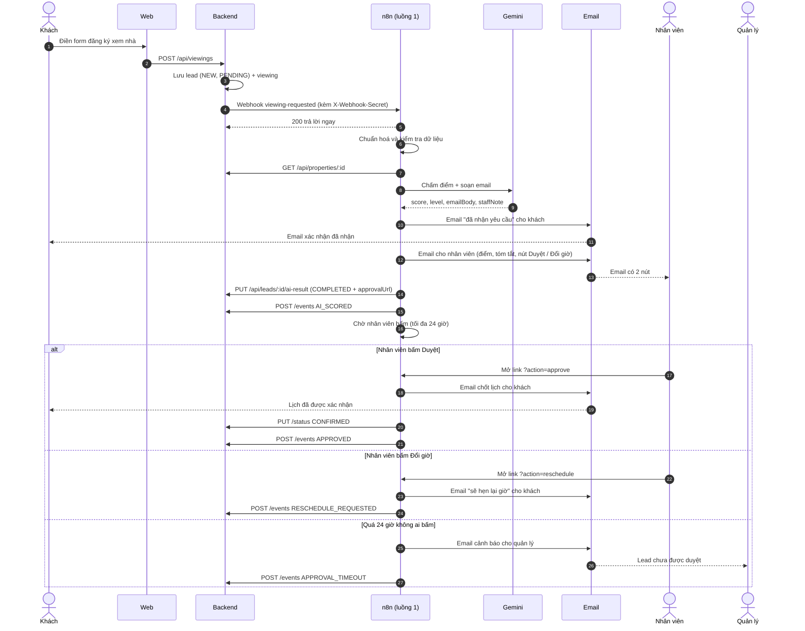

# Luồng 1: Tiếp nhận và chốt lịch xem nhà

File n8n: `n8n-workflows/luong-1-dat-lich.json` · Trigger: **Webhook** `POST /webhook/viewing-requested`

## 1. Ngoài đời luồng này giải quyết việc gì?

Khách vào web, chọn một căn nhà và đăng ký giờ xem. Ở văn phòng môi giới thật, nhân viên phải đọc từng đơn, đoán khách nào đáng gọi trước, gọi hỏi lại, rồi nhắn xác nhận lịch. Luồng này làm thay phần lặp lại:

- AI đọc đơn và **chấm điểm** khách: HOT (rất tiềm năng), WARM (trung bình), COLD (chưa rõ).
- Khách nhận ngay email "đã nhận yêu cầu".
- Nhân viên nhận email có điểm AI, tóm tắt và hai nút: **Duyệt** hoặc **Đổi giờ**.
- Chỉ khi nhân viên bấm Duyệt thì lịch mới được chốt và khách nhận email xác nhận. Đây là bước **người duyệt** (human-in-the-loop): AI không tự chốt lịch.

## 2. Ai tham gia?

| Làn | Là ai | Vai trò |
|---|---|---|
| Khách | Người mua nhà | Điền form trên web, nhận email |
| Web | Next.js | Gửi form lên backend |
| Backend | NestJS + PostgreSQL | Lưu khách, gọi n8n, nhận kết quả |
| n8n | Luồng này | Điều phối từng bước |
| Gemini | AI của Google | Chấm điểm, viết email |
| Email | Gmail SMTP | Gửi thư |
| Nhân viên | Sale | Bấm Duyệt / Đổi giờ |
| Quản lý | Chủ văn phòng | Nhận cảnh báo nếu nhân viên bỏ quên |

## 3. Sơ đồ swimlane

## 4. Từng bước

| Bước | Node n8n | Làm gì | Ghi vào DB |
|---|---|---|---|
| 1 | Webhook | Nhận đơn từ backend, kiểm tra header bí mật (sai thì 403) | |
| 2 | Cấu hình | Đặt địa chỉ backend, email nhân viên và quản lý | |
| 3 | Chuẩn hoá | Cắt khoảng trắng, đổi email về chữ thường, chỉ giữ chữ số của số điện thoại | |
| 4 | Hợp lệ? | Email có `@`, ngân sách ≥ 0, có căn nhà. Sai thì báo `FAILED` | `automationStatus = FAILED` |
| 5 | Lấy thông tin nhà | Gọi backend lấy tên, giá, diện tích căn khách chọn | |
| 6 | Ghép dữ liệu | Tính ngân sách so với giá căn (%) để AI tham khảo | |
| 7 | Basic LLM Chain (Gemini) | Chấm điểm 0–100, xếp HOT/WARM/COLD, viết email, viết gợi ý cho nhân viên | |
| 8 | Tính mức (Code) | **Không tin cấp độ AI trả về**: tự tính lại từ điểm (≥70 HOT, 40–69 WARM, <40 COLD), kiểm tra email AI không rỗng, escape HTML. Lỗi thì báo `FAILED` | |
| 9 | Mức (Switch) | Rẽ ba nhánh theo HOT / WARM / COLD (có nhánh dự phòng báo `FAILED`) | |
| 10 | Email khách HOT/WARM/COLD | Gửi email "đã nhận yêu cầu" (nội dung hơi khác mỗi mức) | |
| 11 | Email nhân viên | Gửi điểm, tóm tắt, hai nút Duyệt và Đổi giờ | |
| 12 | Lưu kết quả AI | Gọi backend lưu điểm và link duyệt | `score, level, reason, aiReply, approvalUrl`, `COMPLETED` |
| 13 | Ghi log AI_SCORED | Ghi dòng thời gian | `lead_events` |
| 14 | Chờ duyệt (Wait) | Dừng, chờ nhân viên bấm link, tối đa 24 giờ | |
| 15 | Kết quả duyệt (Switch) | Rẽ: approve / reschedule / còn lại | |
| 15b | Hết giờ thật? (IF) | Nhánh "còn lại": nếu không có `action` là **hết 24 giờ** → cảnh báo quản lý. Nếu có `action` nhưng sai → trả trang lỗi 400 và **quay lại chờ** (link vẫn dùng được) | |
| 16 | Lấy giờ xem mới nhất (Postgres) → Email chốt lịch → Cập nhật CONFIRMED → log APPROVED → Trả lời duyệt | Email dùng **giờ xem mới nhất trong DB** (nhân viên có thể đã đổi giờ ở web admin trong lúc chờ); **trang "đã ghi nhận" chỉ hiện sau khi email đã gửi** | `leads.status = CONFIRMED` |
| 17 | Email báo đổi giờ → log → Trả lời đổi giờ | Báo khách sẽ hẹn lại | `lead_events` |
| 18 | Email cảnh báo quản lý → log | Báo quản lý khi quá hạn | `lead_events` |

## 5. Nối với hệ thống

- **Vào:** webhook `viewing-requested` do backend gọi (xem `api-contract-dev.md` mục 1).
- **Ra:** `PUT /leads/:id/ai-result`, `PUT /leads/:id/status`, `POST /leads/:id/events`, `PUT /leads/:id/automation-status` (mục 2).
- **Trạng thái khách:** `NEW → CONFIRMED`. **Trạng thái tự động hoá:** `PENDING → COMPLETED` hoặc `FAILED`.
- Nếu link duyệt hết hạn hoặc nhân viên đã bấm Đổi giờ, lịch được chốt bằng [luồng 1b](luong-1b-chot-lich-thu-cong.md).
- **Link Duyệt** chính là `$execution.resumeUrl` của lần chạy đang chờ. Backend lưu link này (`approvalUrl`, không lộ ra API đọc) để web admin và app sau này có nút Duyệt mà n8n vẫn là nơi xử lý duy nhất.

## 6. Khi lỗi thì sao?

- Mọi node gọi dịch vụ ngoài (Gemini, email, HTTP) đều **thử lại 3 lần, cách 5 giây**.
- Email gửi cho nhân viên và khách đã được **escape HTML** (tên, nhu cầu khách nhập, nội dung AI) để khách không chèn được link hay mã vào thư.
- Vẫn lỗi thì nhánh lỗi gọi `PUT .../automation-status` với `FAILED`, để khách không kẹt ở `PENDING`.
- Lỗi khác ngoài dự kiến: **Error workflow** gửi email cho quản lý (xem `error-workflow.md`).

## 7. Cách chạy thử

1. `docker compose up -d --build`, mở n8n (`localhost:5678`), kích hoạt luồng 1.
2. Mở web `localhost:3000`, đăng ký xem nhà bằng email `nhadn2457+khach1@gmail.com`.
3. Kiểm tra: khách nhận email, nhân viên nhận email có 2 nút, bấm Duyệt thì lead sang `CONFIRMED`.
