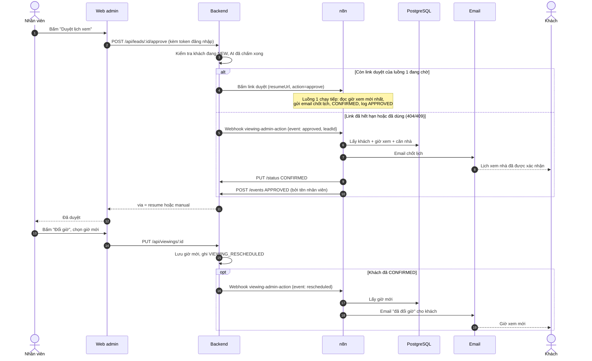

# Luồng 1b: Chốt lịch / báo đổi giờ do nhân viên thao tác trên web admin

> **Trạng thái trên `main`:** luồng n8n đã có. Phần gọi vào luồng này (API duyệt và đổi giờ ở backend, nút trên web admin) do Hậu làm, nên hiện chỉ chạy thử bằng `curl` tới webhook.

File n8n: `n8n-workflows/luong-1b-chot-lich-thu-cong.json` · Trigger: **Webhook** `POST /webhook/viewing-admin-action` (do backend gọi, có header bí mật)

## 1. Ngoài đời luồng này giải quyết việc gì?

Luồng 1 chờ nhân viên bấm **Duyệt** trong email, nhưng ngoài đời hay xảy ra:

- Nhân viên bỏ quên email quá 24 giờ, đến khi nhớ ra thì link duyệt đã hết hạn.
- Nhân viên bấm **Đổi giờ** trong email (luồng 1 chỉ báo khách "sẽ gọi lại") rồi sau đó đã thoả thuận được giờ mới.
- Nhân viên muốn thao tác ngay trên web admin hoặc app, không mở email.

Luồng 1b cho phép chốt lịch **không phụ thuộc link trong email**. Kết quả giống hệt bấm link: khách nhận email chốt lịch, khách chuyển sang `CONFIRMED`, ghi log `APPROVED`. n8n vẫn là nơi duy nhất làm việc này, backend chỉ "gõ cửa" n8n.

Luồng này còn lo việc **báo khách khi nhân viên đổi giờ** cho khách đã chốt lịch (email "Lịch xem nhà đã đổi giờ").

## 2. Ai tham gia?

Nhân viên (web admin), Backend, n8n (luồng 1b), PostgreSQL (n8n đọc), Email, Khách.

## 3. Sơ đồ swimlane



## 4. Từng bước trong luồng 1b

| Bước | Node | Làm gì |
|---|---|---|
| 1 | Webhook | Nhận yêu cầu từ backend, kiểm tra header bí mật |
| 2 | Cấu hình | Địa chỉ backend |
| 3 | Chuẩn hoá | Kiểm tra `leadId` là số nguyên, `event` là `approved` hoặc `rescheduled` |
| 4 | Lấy dữ liệu lịch (Postgres) | Một câu SQL lấy khách, giờ xem mới nhất, căn nhà |
| 5 | Có khách? | Không có thì dừng và báo lỗi (Stop and Error, Error workflow gửi email quản lý) |
| 6 | Chuẩn bị | Escape HTML, đổi giờ sang giờ Việt Nam |
| 7 | Duyệt hay đổi giờ? | Rẽ theo `event` |
| 8a | Email chốt lịch → Cập nhật CONFIRMED → Ghi log APPROVED | Nhánh duyệt |
| 8b | Email báo giờ mới | Nhánh đổi giờ (backend đã tự ghi log `VIEWING_RESCHEDULED`) |

## 5. Nối với hệ thống

- **Vào:** webhook `viewing-admin-action`, body `{ "event": "approved" | "rescheduled", "leadId": 12, "by": "tên nhân viên" }`.
- **Ra:** `PUT /leads/:id/status`, `POST /leads/:id/events`. Đọc DB trực tiếp (node Postgres).
- **Backend phải gọi được n8n**: địa chỉ n8n suy ra từ `N8N_WEBHOOK_URL` (trong Docker là `http://n8n:5678`).
- Link duyệt của luồng 1 (`approvalUrl`) mang địa chỉ công khai của n8n; backend tự đổi sang địa chỉ nội bộ trước khi gọi.

## 6. Khi lỗi thì sao?

- Gọi link duyệt gặp lỗi lạ (không phải hết hạn): backend báo lỗi 502 cho nhân viên và **không** gọi cách dự phòng, để khách không nhận hai email chốt lịch.
- Mọi node có thể lỗi đều thử lại 3 lần. Lỗi cuối cùng: Error workflow gửi email quản lý.
- Đổi giờ thành công nhưng n8n lỗi: giờ mới vẫn được lưu, backend ghi cảnh báo (nhân viên cần báo khách bằng tay).

## 7. Cách chạy thử (chưa có trang admin, dùng `curl`)

1. Import và Publish luồng 1b trong n8n.
2. Chốt lịch: gọi webhook với `event = approved`:

```bash
curl -X POST http://localhost:5678/webhook/viewing-admin-action -H "Content-Type: application/json" -H "X-Webhook-Secret: <WEBHOOK_SECRET>" -d '{"event":"approved","leadId":12,"by":"Nhân viên thử"}'
```

   Kết quả: khách nhận email chốt lịch, `leads.status = CONFIRMED`, có sự kiện `APPROVED`.
3. Báo đổi giờ: gọi lại với `"event":"rescheduled"` cho khách đã `CONFIRMED`; khách nhận email giờ mới.
4. Gọi với `leadId` không tồn tại: luồng dừng báo lỗi và Error workflow gửi email quản lý.
