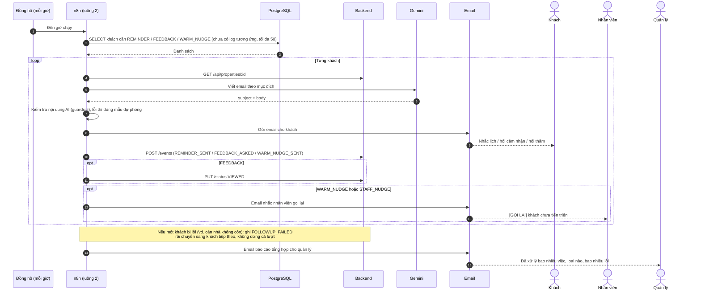

# Luồng 2: Follow-up tự động

File n8n: `n8n-workflows/luong-2-follow-up.json` · Trigger: **Schedule, mỗi giờ** (và nút "Chạy tay" để thử)

## 1. Ngoài đời luồng này giải quyết việc gì?

Nhân viên môi giới thường quên: quên nhắc khách trước giờ xem nhà, quên hỏi cảm nhận sau buổi xem, quên liên lạc lại khách đang nguội dần. Luồng này mỗi giờ tự quét database và gửi đúng email cần gửi, **mỗi loại chỉ gửi một lần cho mỗi khách**.

| Loại | Điều kiện | Việc làm |
|---|---|---|
| `REMINDER` | Khách đã chốt lịch (`CONFIRMED`), giờ xem trong 24 giờ tới | Email nhắc lịch cho khách |
| `FEEDBACK` | Nhân viên đã bấm "Đã xem" (`VIEWED`) và giờ xem đã qua hơn 2 giờ; hoặc nhân viên quên bấm, khách vẫn `CONFIRMED` và giờ xem đã qua hơn 1 ngày | Email hỏi cảm nhận cho khách (trường hợp quên bấm thì n8n chuyển khách sang `VIEWED`) |
| `WARM_NUDGE` | Khách WARM đã `VIEWED`, được hỏi cảm nhận hơn 3 ngày mà chưa tiến triển | Email hỏi thăm khách + email nhắc nhân viên |
| `STAFF_NUDGE` | Khách HOT/WARM đăng ký hơn 3 ngày nhưng vẫn `NEW` (nhân viên chưa duyệt) | **Chỉ** email nhắc nhân viên. Khách không nhận gì, vì lỗi nằm ở phía mình |

## 2. Ai tham gia?

| Làn | Vai trò |
|---|---|
| Đồng hồ (Schedule) | Đánh thức luồng mỗi giờ |
| n8n | Điều phối |
| PostgreSQL | n8n **đọc** trực tiếp để lấy danh sách khách cần chăm |
| Backend | n8n **ghi** (log, đổi trạng thái) qua API |
| Gemini | Viết email cho từng khách |
| Email | Gửi thư |
| Khách / Nhân viên / Quản lý | Nhận thư |

## 3. Sơ đồ swimlane

## 4. Từng bước

| Bước | Node | Làm gì |
|---|---|---|
| 1 | Mỗi giờ / Chạy tay | Khởi động |
| 2 | Cấu hình | Địa chỉ backend, email nhân viên, quản lý |
| 3 | Lấy lead cần follow-up (Postgres) | Một câu SQL gộp 3 loại. `NOT EXISTS` trên `lead_events` đảm bảo **không gửi trùng** |
| 4 | Có dữ liệu? | Không có ai thì dừng |
| 5 | Loop Over Items | Xử lý từng khách một |
| 6 | Lấy thông tin nhà | Tên và địa chỉ căn nhà |
| 7 | Chuẩn bị ngữ cảnh | Ghép mục đích email, giờ xem theo giờ Việt Nam, escape HTML tên/nhu cầu/SĐT |
| 7b | Cần email khách? | `STAFF_NUDGE` bỏ qua AI và email khách, đi thẳng tới ghi log |
| 8 | AI soạn email | Gemini viết `subject` + `body` |
| 9 | Kiểm tra nội dung AI | **Guardrail**: thiếu tên khách, quá dài, còn `{{` thì thay bằng mẫu dự phòng |
| 10 | Email khách | Gửi thư |
| 11 | Ghi log | `POST /events`, vừa là nhật ký vừa là chốt chống gửi trùng |
| 12 | Việc thêm (Switch) | FEEDBACK → đổi `VIEWED`; WARM_NUDGE → email nhắc nhân viên |
| 13 | Tổng hợp + Email báo cáo | Cuối lượt gửi quản lý số liệu |

## 5. Nối với hệ thống

- **Đọc DB trực tiếp** (node Postgres): bảng `leads`, `viewings`, `lead_events`.
- **Ghi qua backend**: `POST /leads/:id/events`, `PUT /leads/:id/status`.
- Loại log: `REMINDER_SENT`, `FEEDBACK_ASKED`, `WARM_NUDGE_SENT`.

## 6. Khi lỗi thì sao?

- Mọi node có thể lỗi đều thử lại 3 lần.
- **Lỗi của một khách không làm dừng cả lượt**: nhánh lỗi ghi `FOLLOWUP_FAILED` cho khách đó rồi đi tiếp. Khách lỗi bị **bỏ qua 6 giờ** để không thử lại mỗi giờ và không chặn hàng đợi (tối đa 50 khách mỗi lượt).
- Email báo cáo cuối lượt có thêm số khách bị lỗi.
- Luồng đã **gắn Error workflow**: lỗi ngoài dự kiến (ví dụ mất kết nối DB) vẫn gửi email cho quản lý.

## 7. Cách chạy thử

1. Nạp dữ liệu mẫu: chạy `backend/sql/demo-follow-up.sql` vào DB (tạo 4 khách, mỗi loại một khách).
2. Mở n8n, bấm **Execute workflow** ở nhánh "Chạy tay".
3. Kiểm tra hộp thư nhóm: 3 email cho khách (nhắc lịch, hỏi cảm nhận, hỏi thăm WARM), 2 email nhắc nhân viên và 1 email báo cáo; trong bảng `lead_events` có `REMINDER_SENT`, `FEEDBACK_ASKED`, `WARM_NUDGE_SENT`, `STAFF_NUDGE_SENT`. Chạy lại thì **không gửi trùng**.
