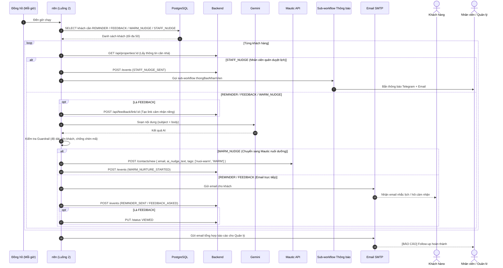

# Luồng 2: Follow-up tự động & Chuyển nuôi dưỡng Mautic

File n8n: `n8n-workflows/luong-2-follow-up.json` · ID: `luong2Realestat0` · Error Workflow: `errorWfRealestat`
Trigger: **Schedule, mỗi giờ** (và nút "Chạy tay" để thử nghiệm)

---

## 1. Ngoài đời luồng này giải quyết việc gì?

Nhân viên môi giới thường quên: quên nhắc khách trước giờ xem nhà, quên hỏi cảm nhận sau buổi xem, quên duyệt lịch hẹn của khách mới, và không đủ thời gian nuôi dưỡng các khách đang nguội dần. 

Luồng 2 mỗi giờ tự động quét database và thực hiện đúng nghiệp vụ cho từng phân khúc khách, **mỗi hành động chỉ thực hiện một lần cho mỗi khách**:

| Loại | Điều kiện kích hoạt | Hành động tự động |
|---|---|---|
| `REMINDER` | Khách đã chốt lịch (`CONFIRMED`), giờ xem trong 24 giờ tới | AI soạn email nhắc lịch chi tiết cho khách (giờ xem, tên căn, địa chỉ) |
| `FEEDBACK` | Giờ xem đã qua: nhân viên đã bấm "Đã xem" (`VIEWED`) qua hơn 2 giờ; hoặc nhân viên quên bấm mà giờ xem qua hơn 1 ngày | Tạo link cảm nhận bảo mật, gửi email hỏi cảm nhận kèm nút "Gửi cảm nhận" (nếu nhân viên quên bấm thì n8n tự đổi sang `VIEWED`) |
| `WARM_NUDGE` (D-10) | Khách WARM đã `VIEWED`, được hỏi cảm nhận hơn 3 ngày mà chưa phản hồi | AI soạn đoạn mở đầu `ai_nudge_text` $\rightarrow$ gọi Mautic API gán field và gắn tag `nuoi-warm` $\rightarrow$ ghi log `WARM_NURTURE_STARTED`. Không gửi mail trực tiếp; Mautic đảm nhận chuỗi chiến dịch nuôi dưỡng tự động |
| `STAFF_NUDGE` | Khách HOT/WARM đăng ký hơn 3 ngày nhưng vẫn `NEW` (nhân viên chưa duyệt) | Kích hoạt Sub-workflow `thongBaoNhanVien` gửi cảnh báo qua **Telegram** và **Email** kèm nút bấm mở chi tiết hồ sơ khách |

---

## 2. Ai tham gia?

| Thành phần | Vai trò |
|---|---|
| Đồng hồ (Schedule) | Đánh thức luồng chạy định kỳ mỗi giờ |
| n8n (Luồng 2) | Điều phối luồng, phân loại tác vụ, xử lý lỗi và tổng hợp |
| PostgreSQL | n8n **đọc** danh sách khách cần chăm sóc (chống gửi trùng bằng `NOT EXISTS`) |
| Backend NestJS | n8n **ghi** (sự kiện dòng thời gian `POST /events`, đổi trạng thái `PUT /status`) |
| Gemini AI | Soạn email nhắc lịch, email cảm nhận và đoạn mở đầu nuôi dưỡng `ai_nudge_text` |
| Mautic 5 REST API | Nhận contact WARM, lưu `ai_nudge_text`, gắn tag `nuoi-warm` để kích hoạt chiến dịch |
| Sub-workflow Thông báo | Nhận cảnh báo `STAFF_NUDGE` và bắn Telegram + Email cho nhân viên |
| Email SMTP | Gửi email nhắc lịch và hỏi cảm nhận tới khách hàng |

---

## 3. Sơ đồ tương tác (Swimlane)

---

## 4. Từng bước trong Workflow (24 nodes)

1. **Mỗi giờ / Chạy tay**: Khởi động luồng định kỳ hoặc chạy thủ công.
2. **Cấu hình**: Thiết lập URL Backend, Mautic API, Webhook Secret, Public Web URL, email quản lý.
3. **Lấy lead cần follow-up (Postgres)**: Truy vấn gộp 4 loại tác vụ với điều kiện loại trừ `NOT EXISTS` để chống trùng.
4. **Có dữ liệu?**: Nếu không có khách nào thì kết thúc lượt chạy.
5. **Loop Over Items**: Lặp qua từng khách hàng một.
6. **Lấy thông tin nhà**: Gọi `GET /api/properties/:id` lấy tên và địa chỉ nhà.
7. **Chuẩn bị ngữ cảnh**: Chuẩn hoá tên, giờ xem theo giờ Việt Nam, mục đích cho AI.
8. **Cần qua AI?**: Rẽ nhánh kiểm tra:
   - Nếu `STAFF_NUDGE`: bỏ qua AI và email khách $\rightarrow$ đi thẳng tới ghi log và thông báo nhân viên.
   - Nếu `REMINDER / FEEDBACK / WARM_NUDGE`: đi vào nhánh xử lý AI.
9. **Là cảm nhận?**: Rẽ nhánh kiểm tra có phải loại `FEEDBACK` không.
10. **Tạo link cảm nhận**: Gọi backend sinh token cảm nhận độc nhất cho khách.
11. **AI soạn email**: Gemini tạo tiêu đề và nội dung theo ngữ cảnh từng khách.
12. **Kiểm tra nội dung AI**: **Guardrail** xác thực tên khách, độ dài, loại bỏ mã lỗi; nếu không đạt thì dùng mẫu dự phòng an toàn.
13. **Là WARM nuôi dưỡng?**:
    - **Nhánh WARM_NUDGE**:
      - **Gửi Mautic Nuôi WARM**: Gọi `POST /contacts/new` Mautic cập nhật `ai_nudge_text` và gắn tag `nuoi-warm, WARM`.
      - **Ghi log WARM Started**: Gọi backend ghi `WARM_NURTURE_STARTED` $\rightarrow$ chuyển sang Gom kết quả.
    - **Nhánh REMINDER / FEEDBACK**:
      - **Email khách**: Gửi email qua SMTP Gmail.
      - **Ghi log**: Gọi backend ghi sự kiện `REMINDER_SENT` hoặc `FEEDBACK_ASKED`.
      - **Việc thêm (Switch)**: Nếu là `FEEDBACK` $\rightarrow$ gọi `Chuyển VIEWED`.
14. **Ghi log STAFF_NUDGE**: Ghi sự kiện `STAFF_NUDGE_SENT` về backend.
15. **Chuẩn bị thông báo NV**: Định dạng tiêu đề, nội dung và nút bấm mở hồ sơ khách.
16. **Thông báo nhân viên**: Kích hoạt Sub-workflow `thongBaoNhanVien` gửi Telegram và Email cho Sale.
17. **Gom kết quả**: Thu thập kết quả xử lý của từng khách.
18. **Ghi lỗi follow-up**: Bắt lỗi nếu bất kỳ bước nào thất bại, ghi `FOLLOWUP_FAILED` (bỏ qua thử lại trong 6 giờ).
19. **Gom lỗi**: Thu thập lỗi để không làm dừng cả mẻ chạy.
20. **Tổng hợp**: Thống kê số lượng từng loại tác vụ (`reminder`, `feedback`, `warmNudge`, `staffNudge`, `failed`, `fallback`).
21. **Có gửi email?**: Kiểm tra nếu có tác vụ được xử lý.
22. **Email báo cáo quản lý**: Gửi email tổng kết cho Quản lý.

---

## 5. Nối với hệ thống & Chống gửi trùng

- **Đọc trực tiếp PostgreSQL:** Đọc các bảng `leads`, `viewings`, `lead_events`.
- **Ghi qua Backend REST API:** Có xác thực `X-Webhook-Secret`.
- **Chống gửi trùng tuyệt đối:**
  - `REMINDER`: `NOT EXISTS (lead_events WHERE type = 'REMINDER_SENT')`
  - `FEEDBACK`: `NOT EXISTS (lead_events WHERE type = 'FEEDBACK_ASKED')`
  - `WARM_NUDGE`: `NOT EXISTS (lead_events WHERE type IN ('WARM_NUDGE_SENT', 'WARM_NURTURE_STARTED'))`
  - `STAFF_NUDGE`: `NOT EXISTS (lead_events WHERE type = 'STAFF_NUDGE_SENT')`
  - Lỗi `FOLLOWUP_FAILED`: Tạm bỏ qua trong vòng 6 giờ để tránh spam hệ thống.

---

## 6. Cách chạy thử

1. Chạy file SQL tạo 4 khách mẫu: `docker exec -i realestate-db psql -U realestate -d realestate < backend/sql/demo-follow-up.sql`
2. Mở n8n UI, chọn workflow `luong-2-follow-up` và bấm **Test step** tại trigger `Chạy tay`.
3. Kết quả kỳ vọng:
   - Khách `Nguyễn Văn Nhắc` nhận email nhắc lịch xem nhà.
   - Khách `Trần Thị Cảm` nhận email hỏi cảm nhận kèm nút bấm.
   - Khách `Phạm Thị Lặng` (WARM) được cập nhật `ai_nudge_text` và tag `nuoi-warm` trên Mautic, backend ghi nhận `WARM_NURTURE_STARTED`.
   - Nhân viên Sale nhận cảnh báo Telegram + Email về khách `Lê Minh Ấm` chưa duyệt lịch.
   - Quản lý nhận 1 email báo cáo tổng hợp đầy đủ số liệu 4 loại việc.
