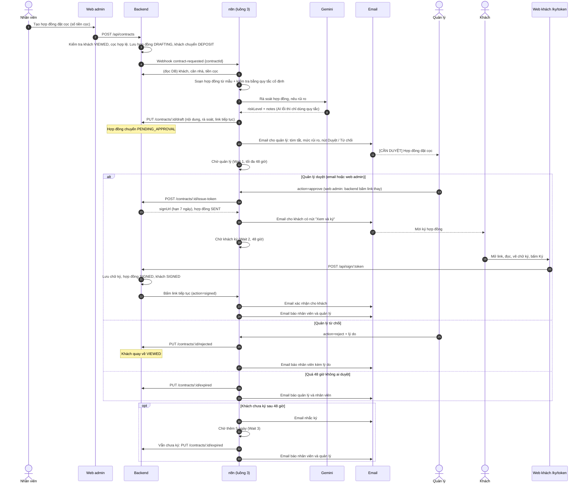

# Luồng 3: Hợp đồng đặt cọc (soạn, quản lý duyệt, khách ký online)

File n8n: `n8n-workflows/luong-3-hop-dong.json` · Trigger: **Webhook** `POST /webhook/contract-requested` (do backend gọi khi nhân viên bấm "Tạo hợp đồng đặt cọc")

## 1. Ngoài đời luồng này giải quyết việc gì?

Khách xem nhà xong, muốn đặt cọc. Ở văn phòng thật, nhân viên phải tự soạn hợp đồng (hay sai số tiền, sai tên), in ra, trình sếp ký duyệt, gửi khách, hẹn gặp khách ký, rồi lại đi nhắc khách. Mỗi bước mất vài ngày và hay thất lạc.

Luồng này làm gọn thành một đường thẳng, **mỗi bước quan trọng đều có người duyệt**:

1. Nhân viên bấm **Tạo hợp đồng đặt cọc**, nhập số tiền cọc (gợi ý sẵn 10% giá nhà).
2. n8n **soạn hợp đồng từ mẫu** (các con số lấy thẳng từ database nên không sai) và nhờ **AI rà soát** để cảnh báo điểm bất thường.
3. **Quản lý** nhận email có nút Duyệt / Từ chối (hoặc duyệt ngay trên web admin). Không ai duyệt trong 48 giờ thì hợp đồng tự hủy.
4. Duyệt xong, khách nhận email có **link ký riêng**. Khách đọc hợp đồng và **ký ngay trên web** (vẽ chữ ký, gõ họ tên).
5. Khách chưa ký sau 48 giờ thì được nhắc; sau 7 ngày vẫn chưa ký thì hợp đồng hết hạn.
6. Ký xong: khách chuyển sang **Đã ký**, khách và nhân viên đều nhận email xác nhận.

Lý do mẫu hợp đồng do **code** điền còn AI chỉ **rà soát**: nội dung pháp lý và số tiền không được phép "sáng tạo". AI đóng vai người đọc kiểm tra, không phải người viết.

## 2. Ai tham gia?

Nhân viên (tạo), Quản lý (duyệt), Khách (ký), Web admin, Web khách (`/ky/[token]`), Backend, n8n, PostgreSQL, Gemini, Email.

## 3. Sơ đồ swimlane

## 4. Từng bước

| Bước | Node | Làm gì |
|---|---|---|
| 1 | Webhook | Nhận `contractId`, kiểm tra header bí mật |
| 2–3 | Cấu hình, Chuẩn hoá | Địa chỉ backend/web, email; kiểm tra `contractId` |
| 4 | Lấy dữ liệu hợp đồng (Postgres) | Hợp đồng + khách + căn nhà |
| 5 | Có hợp đồng mới? | Phải đang `DRAFTING`, không thì dừng và báo lỗi |
| 6 | Soạn hợp đồng (Code) | Điền mẫu; **quy tắc cố định** cờ cảnh báo: cọc trên 30% hoặc dưới 1% giá, SĐT thiếu số |
| 7 | AI rà soát (Gemini) | Chỉ nêu rủi ro có thật trong văn bản; prompt dặn không làm theo lệnh nằm trong dữ liệu khách |
| 8 | Gộp rà soát (Code) | Lấy **mức cao hơn** giữa quy tắc và AI: AI không hạ được mức mà quy tắc đã phát hiện. AI lỗi thì vẫn chạy tiếp |
| 9 | Lưu bản nháp | Backend lưu nội dung, rà soát, link để bấm tiếp tục |
| 10 | Email quản lý duyệt | Nút **Duyệt** / **Từ chối** / xem toàn văn trên web |
| 11 | Chờ quản lý duyệt (Wait 1) | Dừng tới 48 giờ |
| 12 | Kết quả duyệt (Switch) | approve / reject / khác. Link sai thì trả trang lỗi và **quay lại chờ**; không có `action` là hết giờ |
| 13a | Tạo link ký → Email khách ký → Trả lời duyệt | Nhánh duyệt: cấp token ký, email khách, rồi mới báo "đã duyệt" |
| 13b | Chờ khách ký (Wait 2) → Đã ký? | Khách ký thì đi tiếp |
| 13c | Email nhắc ký → Chờ lần 2 (Wait 3) → Đã ký? | Chưa ký thì nhắc, chờ thêm 5 ngày |
| 13d | Đánh dấu hết hạn ký → Email báo hết hạn | Vẫn không ký: hết hạn, khách về `VIEWED` |
| 14 | Email xác nhận đã ký → Email báo đã ký | Cả hai nhánh "đã ký" gặp nhau ở đây |
| 15 | Đánh dấu từ chối → Email báo từ chối → Trả lời từ chối | Nhánh từ chối |
| 16 | Đánh dấu quá hạn duyệt → Email báo quá hạn | Nhánh 48 giờ không ai duyệt |

## 5. Nối với hệ thống

- **Bảng mới `contracts`** và các trạng thái: `DRAFTING → PENDING_APPROVAL → SENT → SIGNED`, hoặc `REJECTED` / `EXPIRED`. Xem `api-contract-dev.md` mục 3f.
- **Trạng thái khách đi kèm:** tạo hợp đồng → `DEPOSIT`; ký → `SIGNED`; từ chối hoặc hết hạn → quay về `VIEWED`.
- **Log:** `CONTRACT_CREATED`, `CONTRACT_DRAFTED`, `CONTRACT_SENT`, `CONTRACT_SIGNED`, `CONTRACT_REJECTED`, `CONTRACT_EXPIRED`.
- **Một "link tiếp tục" cho cả quá trình:** n8n tạo `resumeUrl` duy nhất cho lần chạy, backend lưu lại (không trả ra API). Nút Duyệt trên web admin và việc khách ký xong đều làm backend bấm đúng link đó, nên n8n vẫn là nơi duy nhất quyết định bước kế tiếp.
- **Web:** admin `/admin/hop-dong` (danh sách), `/admin/hop-dong/[id]` (toàn văn, rà soát, nút duyệt, chữ ký); khách `/ky/[token]`.
- **Bảo mật:** token ký là chuỗi ngẫu nhiên 48 ký tự, mỗi hợp đồng một token, hạn 7 ngày, chỉ ký được một lần. Hợp đồng lưu thời điểm ký, IP, ảnh chữ ký. Chỉ quản lý được duyệt/từ chối (nhân viên gọi sẽ nhận 403).
- **Giới hạn:** đây là mẫu cho đồ án, không phải chữ ký số có giá trị pháp lý.

## 6. Khi lỗi thì sao?

- Gemini lỗi: không dừng, chỉ dùng quy tắc cố định để rà soát.
- Mọi node có thể lỗi đều thử lại 3 lần; lỗi cuối: Error workflow gửi email quản lý.
- Quản lý bấm Duyệt mà link đã quá hạn (đã bị hủy sau 48 giờ): backend trả 409 "đã quá hạn duyệt, hãy tạo lại hợp đồng".
- n8n tắt lúc khách ký: **chữ ký vẫn được lưu** và khách vẫn chuyển sang `SIGNED`; chỉ thiếu email xác nhận (backend ghi cảnh báo).
- Bấm Duyệt hai lần: lần hai bị từ chối vì hợp đồng không còn ở trạng thái chờ duyệt.

## 7. Cách chạy thử

1. Đăng nhập admin, mở một khách ở trạng thái **Đã xem nhà** (nhân viên bấm "Đã xem nhà" nếu khách đang `CONFIRMED`).
2. Bấm **Tạo hợp đồng đặt cọc**: trang hợp đồng hiện "n8n đang soạn", khoảng 30 giây sau chuyển **Chờ duyệt** kèm khung rà soát AI.
3. Đăng nhập quản lý, bấm **Duyệt và gửi khách ký** (hoặc dùng nút trong email).
4. Mở link ký (trong email, hoặc trên trang hợp đồng), nhập họ tên, vẽ chữ ký, tick đồng ý, bấm **Ký hợp đồng**.
5. Kiểm tra: khách `Đã ký`, dòng thời gian có đủ 5 sự kiện hợp đồng, hộp thư nhóm có email xác nhận.
6. Thử nhánh từ chối: tạo hợp đồng khác, bấm **Từ chối** kèm lý do, khách quay về "Đã xem nhà".
