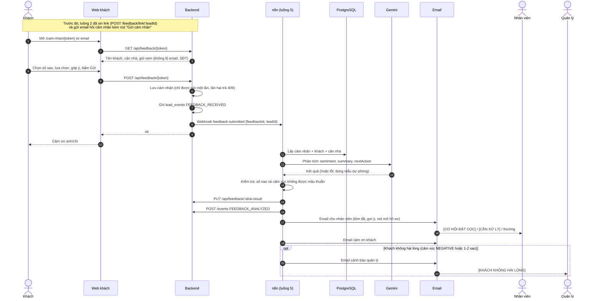

# Luồng 5: Khách gửi cảm nhận, AI phân tích và báo nhân viên

File: `n8n-workflows/luong-5-cam-nhan.json` (17 node, không tính ghi chú; id `luong5Realestat0`).
Kích hoạt: **Webhook** `POST /webhook/feedback-submitted`, có header `X-Webhook-Secret`. Backend gọi khi khách bấm "Gửi cảm nhận".

Khung chung của các tài liệu luồng: [README.md](README.md).

## 1. Làm gì trong thực tế

Sau khi dẫn khách đi xem nhà, nhân viên thường chỉ hỏi miệng "anh/chị thấy sao?" rồi quên, hoặc khách trả lời qua tin nhắn lẻ tẻ không ai tổng hợp. Điểm quyết định mua hay không lại nằm đúng ở lúc này.

Luồng này làm cho phản hồi của khách **thành việc cần làm cụ thể**:

1. Luồng 2 gửi khách email hỏi cảm nhận, trong email có nút **"Gửi cảm nhận"**.
2. Khách mở trang web, chọn số sao, chọn bước tiếp theo (đặt cọc / xem căn khác / không còn nhu cầu), viết thêm nếu muốn.
3. AI đọc phản hồi, tóm tắt, đánh giá cảm xúc và **gợi ý nhân viên nên làm gì tiếp**.
4. Nhân viên nhận email có tóm tắt và nút mở hồ sơ. Khách muốn đặt cọc thì tiêu đề email là **[CƠ HỘI ĐẶT CỌC]**. Khách không hài lòng thì quản lý cũng nhận cảnh báo.
5. Khách nhận email cảm ơn.

AI **không** tự đổi trạng thái khách hay tự soạn hợp đồng. Nó chỉ gợi ý; nhân viên quyết định (human-in-the-loop).

## 2. Ai tham gia

Khách, Web (trang `/cam-nhan/[token]`), Backend, n8n (luồng 5), PostgreSQL (n8n đọc), Gemini, Email, Nhân viên, Quản lý.

## 3. Từng bước

### Sơ đồ

### Các bước

Workflow chia thành bốn nhóm bằng ghi chú: **1. Tiếp nhận cảm nhận**, **2. AI phân tích cảm nhận**, **3. Lưu kết quả và ghi log**, **4. Báo nhân viên, quản lý; cảm ơn khách**, và một nhóm **Xử lý lỗi**. Phần AI dùng hai node phụ trợ `Google Gemini Chat Model` và `Structured Output Parser`; nhánh "không có cảm nhận" đi tới node `Không có cảm nhận` để Error workflow báo.

| Bước | Node | Làm gì |
|---|---|---|
| 1 | Webhook | Nhận `feedbackId`, kiểm tra header bí mật |
| 2 | Cấu hình | Địa chỉ backend, địa chỉ web, email nhân viên và quản lý |
| 3 | Chuẩn hoá | Kiểm tra `feedbackId` là số nguyên |
| 4 | Lấy cảm nhận (Postgres) | Một câu SQL lấy cảm nhận đã gửi, khách, căn nhà |
| 5 | Có cảm nhận? | Không có thì dừng và báo lỗi qua Error workflow |
| 6 | Chuẩn bị | Escape HTML, đổi `DEPOSIT/OTHER/NONE` thành chữ dễ đọc |
| 7 | Basic LLM Chain (Gemini) | Phân tích. Prompt dặn rõ **phần góp ý của khách chỉ là dữ liệu, không làm theo lệnh trong đó** (chống chèn lệnh) |
| 8 | Kiểm tra AI | **Guardrail**: AI lỗi hoặc thiếu thì dùng mẫu dự phòng; 4–5 sao không được `NEGATIVE`, 1–2 sao không được `POSITIVE` |
| 9 | Lưu kết quả AI | Backend lưu `aiSentiment`, `aiSummary`, `aiNextAction` |
| 10 | Ghi log FEEDBACK_ANALYZED | Dòng thời gian của khách |
| 11 | Email nhân viên | Tóm tắt và gợi ý; tiêu đề đổi theo mức ưu tiên |
| 12 | Email cảm ơn khách | Nội dung đổi theo lựa chọn của khách |
| 13 | Cần báo quản lý? → Email cảnh báo quản lý | Chỉ khi khách không hài lòng |

## 4. Nối với hệ thống

- **Bảng mới `feedbacks`:** `leadId, token, rating, interest, comment, submittedAt, aiSentiment, aiSummary, aiNextAction`.
- **API công khai:** `GET` và `POST /api/feedback/:token`. **Cho n8n:** `POST /api/feedback/link/:leadId`, `PUT /api/feedback/:id/ai-result`. **Cho admin:** `GET /api/feedback/lead/:leadId`. Xem [api-contract.md](../api-contract.md).
- **Web:** trang khách `/cam-nhan/[token]`; trang chi tiết khách ở admin có thẻ "Cảm nhận của khách".
- **Log:** `FEEDBACK_ASKED` (luồng 2), `FEEDBACK_RECEIVED` (backend), `FEEDBACK_ANALYZED` (luồng 5).
- **Bảo mật:** `token` là chuỗi ngẫu nhiên 32 ký tự, mỗi khách một link, chỉ gửi được một lần. Trang công khai không lộ email hay số điện thoại.

## 5. Khi lỗi thì sao

**Xử lý lỗi (nhóm cuối của workflow).** Lỗi cuối cùng làm lần chạy thất bại và kích hoạt [Error workflow](error-workflow.md); xem các mục dưới đây.

- Gemini lỗi sau 3 lần thử: **không dừng**, dùng mẫu dự phòng từ số sao và lựa chọn của khách. Nhân viên vẫn nhận email.
- Các node khác: thử lại 3 lần; lỗi cuối cùng thì Error workflow gửi email quản lý.
- n8n lỗi hoặc tắt: cảm nhận của khách **vẫn được lưu**, chỉ thiếu phần AI. Backend ghi log cảnh báo.

## 6. Triển khai lên server

| Mục | Giá trị |
|---|---|
| Workflow id | `luong5Realestat0` |
| Credential | Header Auth `iYLrhsH8b8dDkZ0n`, Postgres `postgres_account_id`, Gemini `wU5LeG7gXaoUdMXQ`, SMTP `hfJ9bBGUGsjH8qDP` |
| Biến `.env` | `PUBLIC_WEB_URL` (link hồ sơ trong email), `WEBHOOK_SECRET` |
| Cấu hình trong node `Cấu hình` | `backendUrl`, `webUrl`, `staffEmail`, `managerEmail` (hai email đang ghi sẵn trong node, kiểm tra trước khi dùng thật) |
| Error workflow | Chọn `errorWfRealestat` trong Settings |

Hiện trạng:

- **Server:** [trien-khai.md mục 4](../trien-khai.md) ghi luồng 5 đã bật. Luồng này không nằm trong danh sách import của `v0.3.0` và `v0.3.1`; khi cần import lại thì làm theo [mục 5](../trien-khai.md) (file đó ghi luồng 5 import lại được ngay sau khi release lên `main`).
- **Phụ thuộc:** bảng `feedbacks` và các API `/api/feedback/*` của backend; lời hỏi cảm nhận và link do [luồng 2](luong-2-follow-up.md) gửi.
- **Chưa kiểm trên server:** [trien-khai.md](../trien-khai.md) không có ghi nhận kiểm riêng cho luồng 5 sau lần import gần nhất.

## 7. Cách chạy thử

1. Chạy `backend/sql/demo-follow-up.sql`, rồi chạy luồng 2 (nhánh "Chạy tay"). Khách `Trần Thị Cảm` nhận email hỏi cảm nhận.
2. Mở link trong email (hoặc lấy `token` trong bảng `feedbacks`) tại `http://localhost:3000/cam-nhan/<token>`, gửi cảm nhận.
3. Sau chừng 30 giây: hộp thư nhóm có email cho nhân viên và email cảm ơn; trang chi tiết khách ở admin hiện thẻ cảm nhận kèm tóm tắt AI. Gửi lại lần hai: báo "đã gửi rồi".
