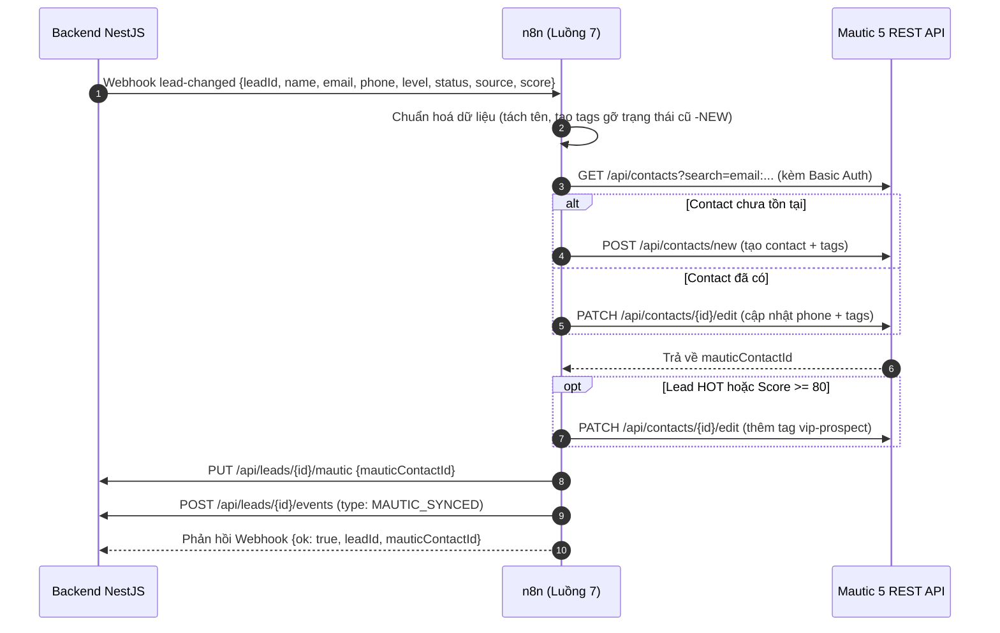

# Luồng 7: Đồng bộ khách hàng sang Mautic Marketing Automation

File n8n: `n8n-workflows/luong-7-dong-bo-mautic.json` · ID: `luong7Realestat0` · Error Workflow: `errorWfRealestat`
Trigger: **Webhook** `POST /webhook/lead-changed` (do backend gọi khi lead có kết quả AI hoặc đổi trạng thái).

---

## 1. Mục tiêu và nghiệp vụ

Hệ thống kết hợp giữa **Quản lý bán hàng (CRM/Backend)** và **Nuôi dưỡng khách hàng tự động (Mautic Marketing Automation)** theo thiết kế chấm điểm hai trục (Quyết định D-10):
- **Trục 1 (AI Score):** Do AI chấm ban đầu (0-100) lưu tại backend (`leads.score`). Không ghi đè vào trường `points` của Mautic.
- **Trục 2 (Mautic Points):** Do Mautic tự cộng điểm hành vi (mở email, bấm link, xem trang).

Quy trình Luồng 7:
1. Khi khách đăng ký có kết quả AI (`ai_result`) hoặc nhân viên cập nhật tiến độ (`status_changed`), backend gọi webhook `lead-changed` sang n8n.
2. n8n tự động:
   - Tìm kiếm Contact trên Mautic theo email (có header Basic Auth).
   - Nếu chưa có: Tạo Contact mới (Họ tên, Email, SĐT, Tags). Không gán `points` để giữ trọn điểm hành vi Mautic.
   - Nếu đã có: Cập nhật thông tin SĐT và Tags.
   - **Xử lý Tags thông minh:** Gắn tag trạng thái mới và tự động gỡ tag trạng thái cũ bằng tiền tố `-` (ví dụ `CONFIRMED`, `-NEW`, `-VIEWED`, `-DEPOSIT`, `-SIGNED`, `-LOST`).
   - Gắn tag phân khúc: `HOT/WARM/COLD`, nguồn `facebook/zalo/google/direct`, và tag `vip-prospect` nếu điểm AI ≥ 80 hoặc mức `HOT`.
   - Lưu ngược `mautic_contact_id` về backend qua `PUT /api/leads/{id}/mautic`.
   - Ghi nhận sự kiện `MAUTIC_SYNCED` vào `lead_events` để hiển thị trên dòng thời gian.
3. Khi gặp sự cố với Mautic API: Kích hoạt cổng lỗi `continueErrorOutput` ghi nhận sự kiện `FOLLOWUP_FAILED` về backend.

---

## 2. Kiến trúc tương tác



---

## 3. Danh sách các bước trong Workflow (14 bước)

1. **Webhook**: Nhận payload sự kiện `lead-changed` từ backend (có Header Auth `X-Webhook-Secret`, đặt `responseMode = responseNode`).
2. **Cấu hình**: Cấu hình địa chỉ nội bộ Mautic (`http://mautic_web:80/api`), backend (`http://backend:8081`), header Basic Auth Mautic (`admin:HoanghauQueen@2026`).
3. **Chuẩn hoá dữ liệu**: Tách họ tên, chuẩn hoá tags, tạo danh sách tag gỡ bỏ trạng thái cũ (`-NEW`, `-VIEWED`...).
4. **Tìm Contact Mautic**: Gửi GET tới Mautic API tra cứu theo email (có Basic Auth, bắt lỗi `continueErrorOutput`).
5. **Contact đã có?**: Rẽ nhánh IF kiểm tra contact đã tồn tại hay chưa.
6. **Tạo Contact mới**: Gọi POST `/contacts/new` tạo mới contact kèm tags.
7. **Cập nhật Contact**: Gọi PATCH `/contacts/{id}/edit` cập nhật thông tin và tags (bảo tồn points).
8. **Gom ID Contact**: Lấy `contactId` từ kết quả tạo mới hoặc cập nhật.
9. **Lead VIP?**: Kiểm tra nếu `level === 'HOT'` hoặc `score >= 80`.
10. **Gắn Tag VIP**: Gắn thêm tag `vip-prospect` cho lead tiềm năng cao.
11. **Lưu mautic_contact_id Backend**: Gọi `PUT /api/leads/{id}/mautic` để lưu ID contact về bảng `leads`.
12. **Ghi nhận Event Backend**: Gọi `POST /api/leads/{id}/events` ghi dòng thời gian `MAUTIC_SYNCED`.
13. **Phản hồi Webhook**: Trả về HTTP 200 JSON cho backend qua node `Respond to Webhook`.
14. **Báo lỗi Backend**: Nhận lỗi từ bất kỳ node gọi Mautic nào và ghi `FOLLOWUP_FAILED` về backend.

---

## 4. Dữ liệu thử nghiệm

Ví dụ payload từ backend:
```json
{
  "event": "lead_changed",
  "trigger": "ai_result",
  "leadId": 15,
  "name": "Nguyễn Văn An",
  "email": "an.nguyen@example.com",
  "phone": "0912345678",
  "level": "HOT",
  "status": "CONFIRMED",
  "source": "facebook",
  "score": 85
}
```

Kết quả trong Mautic:
- Contact Email: `an.nguyen@example.com`
- First Name: `An`, Last Name: `Nguyễn Văn`
- Tags: `HOT`, `CONFIRMED`, `facebook`, `vip-prospect`, `-NEW`, `-VIEWED`, `-DEPOSIT`, `-SIGNED`, `-LOST`
- Điểm tương tác: Giữ nguyên (do Mautic tracking tính, không bị AI score ghi đè).
