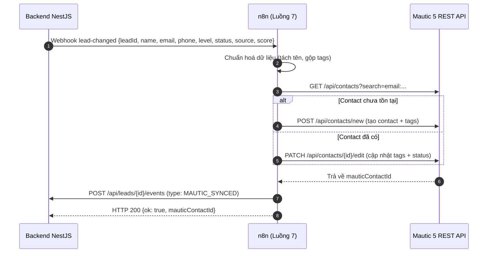

# Luồng 7: Đồng bộ khách hàng sang Mautic Marketing Automation

File n8n: `n8n-workflows/luong-7-dong-bo-mautic.json` · Trigger: **Webhook** `POST /webhook/lead-changed` (do backend gọi khi lead có kết quả AI hoặc đổi trạng thái).

---

## 1. Mục tiêu và nghiệp vụ

Hệ thống kết hợp giữa **Quản lý bán hàng (CRM/Backend)** và **Nuôi dưỡng khách hàng tự động (Mautic Marketing Automation)**:

1. Khi khách đăng ký và được AI chấm điểm (`ai_result`) hoặc nhân viên cập nhật tiến độ (`status_changed`), backend gửi sự kiện sang n8n.
2. n8n tự động:
   - Tìm kiếm Contact trên Mautic theo email (tránh tạo trùng lặp).
   - Nếu chưa có: Tạo Contact mới với đầy đủ thông tin (Họ tên, Email, SĐT, Điểm AI ban đầu).
   - Nếu đã có: Cập nhật thông tin và gắn bộ Tag định danh theo vòng đời.
   - Gắn nhãn phân khúc (Tags):
     - **Mức độ:** `HOT`, `WARM`, `COLD`
     - **Trạng thái:** `NEW`, `CONFIRMED`, `VIEWED`, `DEPOSIT`, `SIGNED`, `LOST`
     - **Nguồn khách:** `facebook`, `zalo`, `google`, `direct`, v.v.
   - Ghi nhận sự kiện `MAUTIC_SYNCED` vào `lead_events` để quản lý theo dõi trên dòng thời gian.
3. Khi Contact đã vào Mautic, Mautic kích hoạt các chiến dịch nuôi khách (Campaigns) theo phân khúc (Segment).

---

## 2. Kiến trúc tương tác



---

## 3. Danh sách các bước trong Workflow (≥ 12 bước)

1. **Webhook**: Nhận payload sự kiện `lead-changed` từ backend (có Header Auth `X-Webhook-Secret`).
2. **Set Config**: Cấu hình địa chỉ nội bộ của Mautic (`http://mautic_web:80/api`) và backend (`http://backend:8081/api`).
3. **Validate Input**: Kiểm tra tính hợp lệ của `email`, `leadId`, `status`.
4. **Format Name & Tags**: Tách họ tên, chuẩn hoá mảng Tags `[level, status, source]`.
5. **Search Contact**: Gửi HTTP GET tới Mautic API tra cứu theo email.
6. **Switch Exists**: Rẽ nhánh kiểm tra contact đã tồn tại hay chưa.
7. **Create Contact**: Tạo contact mới nếu chưa có.
8. **Update Contact**: Cập nhật thông tin và tags nếu đã có.
9. **Merge Contact Result**: Gom kết quả từ 2 nhánh tạo / cập nhật.
10. **Extract Contact ID**: Trích xuất ID contact Mautic.
11. **Check High Score**: Kiểm tra nếu lead `HOT` hoặc điểm ≥ 80 để gắn thêm tag ưu tiên `vip-prospect`.
12. **Tag VIP Prospect**: Gọi API Mautic gắn tag VIP nếu thỏa điều kiện.
13. **Log Backend Event**: Ghi dòng thời gian `MAUTIC_SYNCED` vào backend.
14. **Respond to Webhook**: Trả về phản hồi JSON xác nhận thành công.
15. **Error Handler**: Nhánh bắt lỗi, ghi log `FOLLOWUP_FAILED` về backend nếu Mautic không khả dụng.

---

## 4. Dữ liệu thử nghiệm

Ví dụ payload từ backend:
```json
{
  "event": "lead_changed",
  "trigger": "ai_result",
  "leadId": 15,
  "name": "Nguyễn Văn An",
  "email": "an.nguyen@example.com",
  "phone": "0912345678",
  "level": "HOT",
  "status": "NEW",
  "source": "facebook",
  "score": 85
}
```

Kết quả trong Mautic:
- Contact Email: `an.nguyen@example.com`
- First Name: `An`, Last Name: `Nguyễn Văn`
- Points: `85`
- Tags: `HOT`, `NEW`, `facebook`, `vip-prospect`
