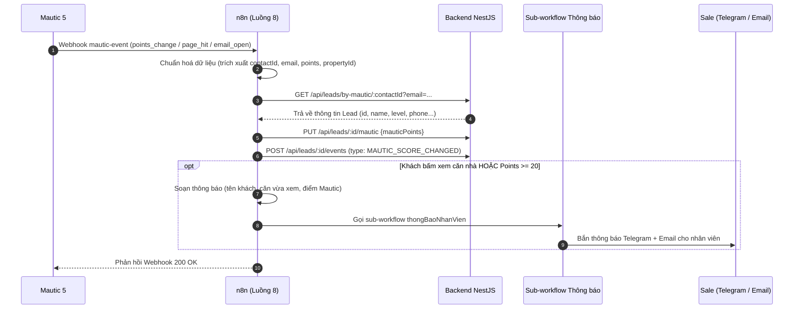

# Luồng 8: Mautic báo về (Marketing Automation Feedback)

File n8n: `n8n-workflows/luong-8-mautic-bao-ve.json` · ID: `luong8Realestat0` · Error Workflow: `errorWfRealestat`
Trigger: **Webhook** `POST /webhook/mautic-event` (do Mautic gửi khi khách hàng mở email, bấm link, xem trang, hoặc đổi điểm tương tác).

---

## 1. Mục tiêu và nghiệp vụ

Luồng 8 hoàn tất **vòng lặp phản hồi Marketing Automation (Data Flywheel)** trong hệ thống bất động sản:
- **Theo dõi hành vi tương tác thực tế:** Mautic tự động tính điểm tương tác khi khách mở mail, click link xem căn nhà, truy cập lại trang web.
- **Đồng bộ về Backend (Trục 2 - Mautic Points):** Điểm tương tác từ Mautic được lưu vào trường `leads.mautic_points` và ghi nhận lịch sử vào `lead_events` với sự kiện `MAUTIC_SCORE_CHANGED`.
- **Cảnh báo nóng cho nhân viên Sale:** 
  - Khi khách **bấm xem lại căn nhà** (page hit `/nha/:id`), hoặc
  - Khi điểm tương tác Mautic **vượt ngưỡng** (ví dụ $\ge 20$ điểm).
  ➔ n8n tự động gọi Sub-workflow `thong-bao-nhan-vien` để bắn thông báo ngay qua **Telegram** và **Email** kèm đường link đến trang chi tiết khách hàng và căn nhà mà khách vừa xem.

---

## 2. Kiến trúc tương tác



---

## 3. Danh sách các bước trong Workflow (14 bước)

1. **Webhook**: Nhận webhook `POST /webhook/mautic-event` từ Mautic (`responseMode = responseNode`).
2. **Cấu hình**: Cấu hình URL backend nội bộ (`http://backend:8081`), Webhook Secret, ngưỡng điểm (`pointThreshold = 20`), và Public Web URL.
3. **Chuẩn hoá dữ liệu**: Phân tích payload Mautic (`mautic.lead_points_change`, `mautic.page_hit`, `mautic.email_on_open`, hoặc custom payload), trích xuất `contactId`, `email`, `points`, `propertyId`, và mô tả hành vi.
4. **Có Contact Mautic?**: Kiểm tra nếu có `contactId` hợp lệ hoặc email. Nếu không có ➔ chuyển sang bước Bỏ qua.
5. **Tìm Lead Backend**: Gọi `GET /api/leads/by-mautic/:contactId?email=...` để tra cứu lead tương ứng trong hệ thống CRM (có bắt lỗi `continueErrorOutput`).
6. **Lead tồn tại?**: Kiểm tra backend có tìm thấy lead tương ứng hay không.
7. **Cập nhật Điểm Mautic**: Gọi `PUT /api/leads/:id/mautic` cập nhật trường `mautic_points` của lead.
8. **Ghi nhận Event Backend**: Gọi `POST /api/leads/:id/events` ghi nhận sự kiện `MAUTIC_SCORE_CHANGED` hiển thị trên dòng thời gian khách hàng.
9. **Cần báo nhân viên?**: Kiểm tra điều kiện tương tác cao: Khách xem căn nhà cụ thể (`propertyId > 0`) HOẶC điểm Mautic $\ge 20$.
10. **Chuẩn bị thông báo**: Soạn nội dung thông báo, tiêu đề, và các nút điều hướng (link xem lead, link xem căn nhà).
11. **Thông báo nhân viên**: Kích hoạt Sub-workflow `thongBaoNhanVien` gửi Telegram và Email cho nhân viên tư vấn.
12. **Báo lỗi Backend**: Nhận lỗi nếu các bước gọi API backend thất bại, ghi log `FOLLOWUP_FAILED`.
13. **Phản hồi Thành công**: Trả về HTTP 200 JSON cho Mautic thông báo đã xử lý thành công.
14. **Bỏ qua & Phản hồi Webhook**: Trả về HTTP 200 JSON nếu contact chưa liên kết với lead trong hệ thống.

---

## 4. Dữ liệu thử nghiệm (Payload mẫu)

### Ví dụ 1: Mautic báo điểm tương tác thay đổi
```json
{
  "mautic.lead_points_change": [
    {
      "contact": {
        "id": 2,
        "points": 25,
        "email": "hauphanbtm.110606@gmail.com"
      },
      "points": {
        "old_points": 10,
        "new_points": 25
      }
    }
  ]
}
```

### Ví dụ 2: Khách bấm xem lại căn nhà từ email nuôi dưỡng
```json
{
  "mautic.page_hit": [
    {
      "contact": {
        "id": 2,
        "points": 30,
        "email": "hauphanbtm.110606@gmail.com"
      },
      "hit": {
        "url": "http://localhost:3000/nha/3",
        "urlTitle": "Nhà phố Thủ Đức 3 phòng ngủ"
      }
    }
  ]
}
```

---

## 5. Kết quả ghi nhận trong hệ thống

- **Bảng `leads`:** Cột `mautic_points` tự động cập nhật số điểm mới nhất.
- **Bảng `lead_events`:** Dòng sự kiện `MAUTIC_SCORE_CHANGED` xuất hiện trên timeline web admin.
- **Telegram / Email Sale:** Nhân viên nhận cảnh báo ngay lập tức:
  > 🔴 **[ƯU TIÊN] Khách xem lại căn #3**  
  > Khách hàng Nguyễn Văn A (0942881754) vừa có tương tác mới trên Mautic:  
  > - Hành vi: Khách xem trang: Nhà phố Thủ Đức 3 phòng ngủ  
  > - Điểm Mautic hiện tại: 30  
  > [Xem chi tiết khách] [Xem căn nhà]
