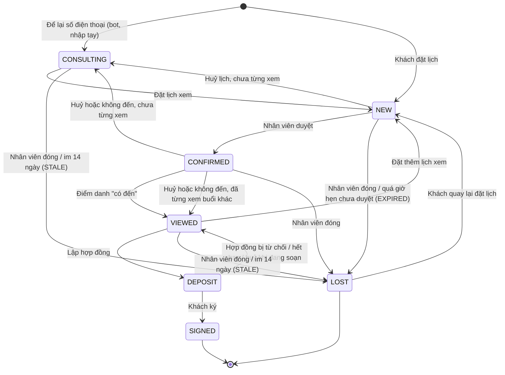

# Vai trò, quyền, trạng thái và bản đồ hành trình

File này là luật chung của hệ thống và là **trang đọc đầu tiên** của `docs/nghiep-vu/`: hành trình khách đi qua những giai đoạn nào, ai được làm gì, mỗi đối tượng (lead, buổi xem, căn nhà, hợp đồng) có những trạng thái nào. Quy tắc chi tiết chia theo **4 vế của đề tài** (*Visits, document signing, lead follow-up, sales analytics*), cộng một file nền:

| File | Vế đề tài | Giai đoạn |
|---|---|---|
| [00-tiep-nhan.md](00-tiep-nhan.md) | Nền (thu lead, chia sale) | GĐ1, GĐ2, phần máy của GĐ4 |
| [01-visits.md](01-visits.md) | **Visits** | GĐ5, phần đầu GĐ6 (điểm danh, vắng mặt) |
| [02-document-signing.md](02-document-signing.md) | **Document signing** | GĐ8, GĐ9 |
| [03-lead-follow-up.md](03-lead-follow-up.md) | **Lead follow-up** | GĐ3, phần sau GĐ6 (cảm nhận), GĐ7, GĐ12; Mautic (mở rộng) |
| [04-sales-analytics.md](04-sales-analytics.md) | **Sales analytics** | Dữ liệu của mọi giai đoạn |

Tài liệu luồng trong `docs/luong/` chỉ link về đây, không chép lại quy tắc. Nếu code chạy khác với các file này, báo trong nhóm để sửa một trong hai, không để lệch. Kế hoạch dẫn tới cách chia này: [../ke-hoach-hanh-trinh-va-luong-n8n.md](../ke-hoach-hanh-trinh-va-luong-n8n.md).

Cập nhật lần cuối: 18/11/2026.

## 1. Bản đồ hành trình khách

### 1.1. Cách đọc nhãn

Các file nghiệp vụ mô tả **hành trình đích**: cả phần đã chạy và phần đã chốt sẽ làm. Mỗi quy tắc gắn một nhãn:

| Nhãn | Nghĩa |
|---|---|
| **[Đang chạy]** | Code đã có trên nhánh `dev`. Server có thể đang chạy bản cũ hơn: xem [../trien-khai.md](../trien-khai.md) |
| **[Sắp làm FE-xx]** | Đã chốt, đã cấp mã task trong [../danh-sach-task.md](../danh-sach-task.md), chưa có code. Làm xong task thì đổi nhãn thành "Đang chạy" trong cùng PR |
| **[Đang làm FE-xx]** | Có người đang làm, chưa merge |
| **[Làm sau]** | Làm nếu còn thời gian trước 3/12; không làm thì ghi vào "hạn chế đã biết" của báo cáo |
| **[Mở rộng]** | Marketing Automation qua Mautic, ngoài đề tài, đóng băng |
| (đề xuất) | Ý của người viết tài liệu, chưa ai chốt; chốt ở change OpenSpec của task tương ứng |

### 1.2. Các giai đoạn

Khung 12 giai đoạn lấy theo các CRM bất động sản (Follow Up Boss, Sierra Interactive, Wise Agent; nguồn ở mục 11 của kế hoạch). Nguyên tắc chia việc: **máy làm việc lặp lại, theo giờ, theo quy tắc; người làm việc cần phán đoán và quan hệ; AI chỉ gợi ý, người duyệt ở bước quan trọng.**

```
 [1 Thu lead] -> [2 Chạm đầu] -> [3 Cố liên hệ] -> [4 Sàng lọc]
                                      |  (hết bậc nhắc vẫn không liên lạc được)
                                      v
                                 [12 Nuôi / Đóng] <---------------+
                                                                   |
 [4] -> [5 Hẹn xem] -> [6 Sau buổi xem] -> [7 Tìm tiếp] --+        |
                           |  (vắng: mời hẹn lại)          |       |
                           v                               |       |
                     [8 Thương lượng] <--------------------+       |
                           |                                       |
                           v                     (im lặng lâu) ----+
                     [9 Cọc + Ký] -> [10 Công chứng] -> [11 Sau bán]
                                     (ngoài hệ thống)   (ngoài phạm vi)
```

| GĐ | Giai đoạn | Máy làm (n8n, AI) | Người làm | Luồng | Vế đề tài | File | Tình trạng |
|---|---|---|---|---|---|---|---|
| 1 | Thu lead | Chuẩn hoá số, nhận khách cũ, chia sale lần lượt, bot ghi nhận khách | Nhập khách hotline, văn phòng | L1, L6 | Nền | 00 | Đang chạy |
| 2 | Chạm đầu tiên | Thư "đã nhận" ngay, báo sale, hạn 2 giờ, quá hạn báo quản lý | Sale gọi, duyệt lịch | L1, L2, Thông báo | Lead follow-up | 00 | Đang chạy |
| 3 | Cố liên hệ | Nhắc sale ngày 1, 3, 7 kèm gợi ý AI | Sale gọi, ghi kết quả từng lần | L9 | Lead follow-up | 03 | Sắp làm FE-43 đến FE-45 |
| 4 | Sàng lọc | AI chấm HOT/WARM/COLD; bot hỏi nhu cầu, RAG trả lời về căn | Hỏi ngân sách, vay, thời gian mua | L1, L6, L6b | Nền | 00 | Đang chạy |
| 5 | Hẹn xem | Kiểm tra khung giờ, thư chốt lịch, nhắc 24 giờ, đóng lịch quá hạn | Duyệt, đổi giờ, dẫn đi xem | L1, L1b, L2 | **Visits** | 01 | Đang chạy |
| 6 | Sau buổi xem | Nhắc điểm danh; gửi link cảm nhận, AI phân tích, tạo việc có hạn; khách vắng thì mời hẹn lại | Điểm danh, gọi lại | L2, L5, L5b | **Visits**, **Lead follow-up** | 01, 03 | Đang chạy; mời hẹn lại sắp làm FE-46 |
| 7 | Tìm tiếp | Bot tìm căn theo tiêu chí | Sale gợi ý căn khác | L6 | Lead follow-up | 03 | Gợi ý tự động: làm sau |
| 8 | Thương lượng | Ghi giá thoả thuận và lịch sử đổi | Mặc cả giá, điều kiện | | Document signing | 02 | Đang chạy |
| 9 | Đặt cọc, ký | AI soạn và rà hợp đồng, chờ duyệt, link ký, nhắc ký, hết hạn tự trả căn; PDF, hash, lưu trữ | Quản lý duyệt, khách ký, quản lý xác nhận cọc | L3 | **Document signing** | 02 | Đang chạy; lưu trữ sắp làm FE-49 |
| 10 | Công chứng, sang tên | | Thủ tục ở cơ quan nhà nước | | | | Ngoài hệ thống |
| 11 | Sau bán | | | | | | Ngoài phạm vi |
| 12 | Nuôi hoặc đóng | Lead im 7 ngày nhắc sale, 14 ngày tự đóng `STALE`; Mautic nuôi khách đồng ý nhận tin | Sale duyệt thư AI soạn | L9; L7, L8 | **Lead follow-up** | 03 | Sắp làm FE-45; Mautic mở rộng |
| Mọi GĐ | Phân tích | Báo cáo tuần, cảnh báo theo quy tắc, AI Agent nhận xét | Quản lý đọc, quyết định | L4 | **Sales analytics** | 04 | Đang chạy; số liệu mới FE-23, FE-47 |

## 2. Hệ thống mô phỏng gì

Một văn phòng môi giới bất động sản nhận bán nhà cho chủ nhà hoặc chủ đầu tư và tìm người mua. Khách xem danh sách nhà, đặt lịch xem, đi xem, rồi đặt cọc nếu muốn mua. AI và n8n làm phần lặp lại (chấm điểm khách, soạn thư, nhắc việc, soạn hợp đồng, tổng hợp số liệu); con người duyệt ở các bước quan trọng.

Mỗi khách có một sale phụ trách: hệ thống chia lần lượt cho các sale đang nhận khách, quản lý chuyển sang sale khác bất cứ lúc nào, mọi lần chia và chuyển được ghi vào nhật ký của khách ([00-tiep-nhan.md](00-tiep-nhan.md) mục 4). Cả đội vẫn xem được danh sách khách; người thao tác được ghi tên vào nhật ký.

## 3. Phạm vi

**Có làm:** toàn bộ vòng đời của khách, từ lúc liên hệ lần đầu đến lúc ký hợp đồng đặt cọc, quản lý xác nhận đã nhận tiền cọc và đánh dấu căn đã bán. Cộng với chăm sóc khách, đóng lead bị bỏ quên và báo cáo kinh doanh hằng tuần.

**Không làm** (ghi vào mục hướng phát triển của báo cáo):

| Việc | Lý do |
|---|---|
| Hoa hồng, lương của sale | Việc của kế toán, nhân sự; không thuộc đề tài |
| Tự động thu hồi khách khi sale chậm | Quá hạn phản hồi thì báo quản lý, quản lý chuyển tay |
| Thanh toán, hợp đồng mua bán công chứng, sang tên | Hệ thống dừng ở hợp đồng đặt cọc và "đã bán" |
| Khách tự chọn giờ mới khi đổi lịch | Khách chỉ gửi yêu cầu, nhân viên chọn giờ |
| Gộp các hồ sơ trùng đã có từ trước trong database | Từ FE-33 khách mới được nhận ra bằng số điện thoại; hồ sơ trùng cũ cần quản lý duyệt riêng |
| SMS, Zalo, gọi điện tự động | Kênh gửi khách là email, kênh báo nhân viên là email, Telegram, thông báo đẩy. Ở Việt Nam kênh chính là Zalo và điện thoại: ghi là hạn chế đã biết |
| Sau bán (xin đánh giá, xin giới thiệu) | Ngoài vòng đời đặt cọc |

## 4. Vai trò và quyền

| Vai | Là ai | Đăng nhập |
|---|---|---|
| Khách | Người muốn mua nhà | Không cần tài khoản. Thao tác qua web khách, Telegram, hoặc link có mã riêng gửi qua email |
| Sale (`SALE`) | Nhân viên bán hàng | Tài khoản web admin |
| Quản lý (`MANAGER`) | Trưởng văn phòng | Tài khoản web admin |
| Tự động | n8n và AI | Gọi API backend bằng header `X-Webhook-Secret`. Mọi thao tác ghi dữ liệu đều đi qua backend |

| Việc | Khách | Sale | Quản lý | Tự động |
|---|---|---|---|---|
| Xem nhà, đặt lịch xem qua web, Telegram | ✅ | | | Trợ lý AI trên Telegram đặt lịch hộ khách |
| Huỷ lịch hoặc xin đổi lịch bằng link quản lý lịch | ✅ | | | |
| Gửi cảm nhận sau buổi xem (link `/cam-nhan/<mã>`) | ✅ | | | Hỏi cảm nhận, AI phân tích |
| Ký hợp đồng đặt cọc (link `/ky/<mã>`) | ✅ | | | Gửi link, nhắc ký |
| Thêm khách (nhập tay) | | ✅ | ✅ | |
| Duyệt lịch, đổi giờ xem | | ✅ | ✅ | Nhắc khi chưa duyệt |
| Điểm danh buổi xem (có đến, không đến) | | ✅ | ✅ | Nhắc khi chưa điểm danh; mời khách vắng hẹn lại *(FE-46)* |
| Ghi chú, ghi kết quả chăm sóc phản hồi | | ✅ | ✅ | Tạo việc, nhắc sale, báo quản lý |
| Đánh dấu "Đã liên hệ được", ghi lần gọi không được *(FE-44)* | | ✅ | ✅ | Tự ghi "đã liên hệ được" khi điểm danh "có đến"; nhắc sale theo bậc ngày 1, 3, 7 cho lead "Đang tư vấn", "Mới" |
| Duyệt và sửa thư AI soạn trước khi gửi khách *(FE-45)* | | ✅ | ✅ | AI gợi ý việc nên làm và soạn nháp |
| Đánh dấu "Không mua" kèm lý do | | ✅ | ✅ | Đóng lead quá hạn chưa duyệt (`EXPIRED`), lead nguội 14 ngày (`STALE`, *FE-45*) |
| Lập hợp đồng đặt cọc, chọn căn, soạn lại hoặc huỷ hợp đồng kẹt | | ✅ | ✅ | AI soạn và rà nội dung |
| Duyệt hoặc từ chối hợp đồng | | | ✅ | |
| Xác nhận "Đã nhận tiền cọc", đánh dấu căn "Đã bán" | | | ✅ | |
| Chuyển khách sang sale khác | | | ✅ | |
| Thêm, sửa, ẩn, xoá căn nhà | | | ✅ | |
| Xem báo cáo tuần, bấm tạo báo cáo ngay | | | ✅ | Lập báo cáo mỗi thứ Hai |
| Xem trang Đội sale, lọc danh sách khách theo người phụ trách | | | ✅ | Sale không thấy mục này và ô lọc |
| Tạo tài khoản nhân viên | | | ✅ | |
| Xem danh sách khách, lịch xem, hợp đồng, số liệu tổng quan | | ✅ | ✅ | |

### 4.1. Khách nhận thông tin qua đâu

Khách không có tài khoản. Hệ thống gửi cho khách qua email; mỗi việc cần khách làm đi kèm một **link riêng có mã bí mật**: ai có link thì mở được đúng một việc của đúng một khách. Thư gửi khách là thư tự động: khách thao tác bằng link, không bằng cách trả lời thư. Thư khách trả lời vào hộp thư chung của văn phòng, hệ thống không đọc.

| Lúc nào | Khách nhận | Link riêng | Cần đồng ý nhận tin |
|---|---|---|---|
| Vừa đặt lịch | Thư báo đã nhận yêu cầu (nội dung theo mức khách) | | Không |
| Nhân viên duyệt | Thư chốt lịch: căn, địa chỉ, giờ xem | `/lich/<mã>`: xem lịch, huỷ, xin đổi lịch | Không |
| Nhân viên đổi giờ | Thư báo giờ mới | `/lich/<mã>` (cùng link) | Không |
| Trong 24 giờ trước giờ hẹn | Thư nhắc lịch | | Không |
| Đã qua giờ hẹn 2 giờ, khách có đến | Thư hỏi cảm nhận | `/cam-nhan/<mã>` | Không |
| Khách không đến, không hẹn lại *(FE-46)* | Thư mời hẹn lại | `/nha/<số>`: chọn giờ mới | Không (thư dịch vụ) |
| Lead im lặng hoặc chưa liên hệ được, sale đã duyệt *(FE-45)* | Thư do AI soạn, sale đã sửa và duyệt | | **Có** |
| Quản lý duyệt hợp đồng | Thư mời ký | `/ky/<mã>`: đọc và ký hợp đồng | Không |
| 48 giờ chưa ký | Thư nhắc ký | `/ky/<mã>` (cùng link) | Không |
| Ký xong | Thư xác nhận đã ký | `/hop-dong/<mã>`: xem lại, in hoặc lưu PDF | Không |
| Khách đồng ý nhận tin *(mở rộng)* | Chuỗi email nuôi khách, bản tin của Mautic | | **Có** |

Khách cũng chat với trợ lý AI trên Telegram để tìm nhà, hỏi đáp, đặt lịch và tra các lịch đã đặt. Muốn tra lịch, khách phải nhập đúng cả email và số điện thoại đã dùng khi đặt.

Vì sao không làm đăng nhập cho khách:

- Khách xem nhà thường chỉ đặt một vài lần; bắt tạo tài khoản dễ làm khách bỏ ngang.
- Mỗi link chỉ làm được một việc và có điều kiện riêng (link quản lý lịch hết dùng được khi tới giờ hẹn, link ký hết hạn sau 7 ngày), nên lộ link cũng chỉ ảnh hưởng một việc.
- Khách mất email thì liên hệ nhân viên; nhân viên làm thay được mọi việc trên web admin.

## 5. Trạng thái

### 5.1. Lead (một khách)

**Một lead là một khách**, nhận ra bằng số điện thoại đã chuẩn hoá. Một lead có nhiều buổi xem (mục 5.2), mỗi lúc tối đa một buổi đang mở. Trang chi tiết lead hiện lịch sử các buổi xem, và mục "Các lần đặt khác" cho các lead cũ trùng số điện thoại (dữ liệu trước FE-33 chưa gộp).

| Mã | Nhãn trên web | Nghĩa |
|---|---|---|
| `CONSULTING` | Đang tư vấn | Có hồ sơ nhưng chưa có buổi xem nào đang mở: khách để lại số qua bot hoặc nhân viên nhập tay, hoặc buổi xem vừa bị huỷ, khách không đến |
| `NEW` | Mới | Có buổi xem vừa đặt, chờ nhân viên duyệt |
| `CONFIRMED` | Đã chốt lịch | Nhân viên đã duyệt, chờ đến giờ xem |
| `VIEWED` | Đã xem nhà | Khách đã đến xem (đã điểm danh) |
| `DEPOSIT` | Đang làm hợp đồng cọc | Đã lập hợp đồng, chờ duyệt hoặc chờ khách ký |
| `SIGNED` | Đã ký hợp đồng cọc | Khách đã ký. Trạng thái cuối |
| `LOST` | Không mua | Khách không mua nữa, luôn kèm lý do. Mở lại được khi khách đặt lịch lại |

"Đã liên hệ được" **không** phải trạng thái: là một mốc thời gian trên lead (`contacted_at`) dùng cho bậc nhắc và báo cáo *(FE-43)*.



| Từ → Đến | Ai, khi nào |
|---|---|
| (chưa có) → `CONSULTING` | Khách để lại số điện thoại qua bot, hoặc nhân viên nhập tay |
| (chưa có) → `NEW` | Khách đặt lịch lần đầu qua web, Telegram |
| `CONSULTING`, `VIEWED`, `LOST` → `NEW` | Khách (cùng số điện thoại) đặt lịch xem: buổi xem mới gắn vào lead cũ. Lead `LOST` được mở lại và xoá lý do đóng. Không đặt được khi đang có buổi xem mở, hoặc khi đang `DEPOSIT` / `SIGNED` |
| `NEW` → `CONFIRMED` | Nhân viên duyệt bằng nút trong thông báo hoặc trên web admin. Không duyệt được khi AI chưa chấm điểm xong |
| `NEW`, `CONFIRMED` → `VIEWED` hoặc `CONSULTING` | Khách tự huỷ bằng link quản lý lịch. Chỉ buổi xem chuyển "Đã huỷ"; lead về `VIEWED` nếu khách từng đến một buổi khác, không thì về `CONSULTING`. Lead **không** bị đóng |
| `NEW` → `LOST` (`EXPIRED`) | Tự động: giờ hẹn đã qua mà chưa ai duyệt |
| `CONFIRMED` → `VIEWED` | Nhân viên điểm danh "có đến" |
| `CONFIRMED` → `VIEWED` hoặc `CONSULTING` | Nhân viên điểm danh "không đến" và không hẹn lại (như khi khách huỷ). Lead không bị đóng |
| `CONFIRMED` → `CONFIRMED` (giờ mới) | Nhân viên đổi giờ, hoặc điểm danh "không đến" và chọn hẹn lại |
| `VIEWED` → `DEPOSIT` | Nhân viên lập hợp đồng đặt cọc |
| `DEPOSIT` → `VIEWED` | Hợp đồng bị quản lý từ chối, hết hạn, hoặc bị huỷ khi còn đang soạn |
| `DEPOSIT` → `SIGNED` | Khách ký hợp đồng |
| `CONSULTING`, `NEW`, `CONFIRMED`, `VIEWED` → `LOST` | Nhân viên bấm "Không mua" kèm lý do. Buổi xem còn chờ thì chuyển "Đã huỷ" |
| `CONSULTING`, `VIEWED` → `LOST` (`STALE`) | *(FE-45)* Tự động: 14 ngày không có hoạt động, không có buổi xem mở, không có hợp đồng còn hiệu lực. Báo quản lý |

Khách đang `DEPOSIT` **không** bấm "Không mua" được: quản lý phải từ chối hợp đồng trước, lead tự về `VIEWED`, căn tự về "Đang bán", rồi mới đóng lead nếu khách thật sự không mua. Trên trang chi tiết lead, nút "Không mua" ẩn đi và thay bằng dòng hướng dẫn. Nếu vẫn gọi API, backend trả `400`: "Khách đang đặt cọc, chưa chuyển sang "Không mua" được. Quản lý từ chối hợp đồng trước, khách sẽ về "Đã xem nhà"." `SIGNED` không đổi được nữa.

**Lý do "Không mua"**

| Mã | Nhãn | Ai ghi | Tình trạng |
|---|---|---|---|
| `NOT_INTERESTED` | Không còn nhu cầu | Nhân viên | [Đang chạy]; từ FE-44 chỉ còn ở dữ liệu cũ và kết quả "Không mua" của theo dõi phản hồi |
| `OTHER` | Lý do khác | Nhân viên (mặc định khi không chọn) | [Đang chạy] |
| `EXPIRED` | Quá hạn không xử lý | Hệ thống: giờ hẹn qua mà chưa duyệt | [Đang chạy] |
| `NO_SHOW` | Khách không đến xem | Hệ thống | Chỉ còn ở dữ liệu trước FE-34 |
| `CUSTOMER_CANCELLED` | Khách tự huỷ lịch | Hệ thống | Chỉ còn ở dữ liệu trước FE-34 |
| `PRICE_TOO_HIGH` | Giá cao | Nhân viên | [Sắp làm FE-43, FE-44] |
| `CHOSE_OTHER_PROPERTY` | Chọn căn khác | Nhân viên | [Sắp làm FE-43, FE-44] |
| `BOUGHT_ELSEWHERE` | Đã mua nơi khác | Nhân viên | [Sắp làm FE-43, FE-44] |
| `UNREACHABLE` | Không liên lạc được | Nhân viên | [Sắp làm FE-43, FE-44] |
| `NO_LONGER_NEEDED` | Hết nhu cầu | Nhân viên | [Sắp làm FE-43, FE-44] |
| `STALE` | Lead nguội, không ai xử lý | Hệ thống: im 14 ngày | [Sắp làm FE-43, FE-45] |

Từ FE-44, nhân viên đóng tay chỉ chọn được 6 lý do của nhân viên (danh sách `MANUAL_LOST_REASONS`); gửi lý do của hệ thống bị từ chối. Nhãn tiếng Việt của các mã mới chốt lại ở FE-43 (`LOST_REASON_LABELS` trong `web/src/lib/api.ts`). Khách mất trước khi có lý do (dữ liệu cũ) để trống.

**Mức khách** do AI chấm khi tạo lead, theo điểm 0–100: `HOT` từ 70, `WARM` từ 40 đến 69, `COLD` dưới 40 ([00-tiep-nhan.md](00-tiep-nhan.md) mục 5).

**Trạng thái xử lý AI** của lead: `PENDING` (đang chấm), `COMPLETED` (chấm xong), `FAILED` (luồng tự động lỗi giữa chừng; nhân viên vẫn xử lý tay được).

### 5.2. Buổi xem

Một lead có thể có nhiều buổi xem, nhưng mỗi lúc **tối đa một buổi đang mở** (`NEW`). Buổi xem đã kết thúc giữ lại làm lịch sử. Đổi giờ thì sửa giờ trên buổi đang mở, giờ cũ ghi vào nhật ký.

| Mã | Nhãn | Từ đâu |
|---|---|---|
| `NEW` | Chờ xem | Khi khách đặt lịch; vẫn `NEW` khi đổi giờ |
| `ATTENDED` | Khách đã đến | Điểm danh "có đến" |
| `NO_SHOW` | Khách không đến | Điểm danh "không đến" và không hẹn lại |
| `CANCELLED` | Đã huỷ | Khách huỷ bằng link, nhân viên bấm "Không mua" khi buổi xem còn chờ, hoặc hệ thống đóng lịch quá hạn |

Dữ liệu trước FE-19 có buổi xem để `NEW` dù khách đã xem, vì lúc đó chưa có điểm danh.

### 5.3. Căn nhà

| Mã | Nhãn | Hiện cho khách | Nhận đặt lịch |
|---|---|---|---|
| `AVAILABLE` | Đang bán | Có | Có |
| `RESERVED` | Đang giữ cọc | Có | Không |
| `SOLD` | Đã bán | Không | Không |
| `HIDDEN` | Đã ẩn | Không | Không |

| Từ → Đến | Ai, khi nào |
|---|---|
| (chưa có) → `AVAILABLE` hoặc `HIDDEN` | Quản lý thêm căn |
| `AVAILABLE` ↔ `HIDDEN` | Quản lý ẩn hoặc hiện lại |
| `AVAILABLE` → `RESERVED` | Tự động khi nhân viên lập hợp đồng cho căn |
| `RESERVED` → `AVAILABLE` | Tự động khi hợp đồng bị từ chối, hết hạn hoặc bị huỷ khi đang soạn, và căn không còn hợp đồng nào khác |
| `RESERVED` → `SOLD` | Quản lý, chỉ khi hợp đồng của căn đã ký |

Căn đang có hợp đồng còn hiệu lực thì quản lý không đổi trạng thái được (trừ chuyển sang "Đã bán" như trên).

#### Thông tin căn nhà cho khách xem (FE-31)

Quản lý nhập trong form sửa căn ở mục **Quản lý nhà**. Ô nào để trống thì trang chi tiết nhà không hiện dòng đó.

| Nhóm trong form | Gồm | Hiện ở trang khách |
|---|---|---|
| Thông tin chính | Tên, địa chỉ, giá, diện tích, loại, link ảnh đại diện, mô tả | Đầu trang, thẻ căn ở trang chủ |
| Thông tin chi tiết | Phòng ngủ (0 = studio), phòng tắm/WC, số tầng (căn hộ: tầng của căn), diện tích đất, diện tích sàn, đường/hẻm trước nhà (m), hướng, pháp lý, nội thất, tình trạng sử dụng | Khối "Thông tin cơ bản"; số phòng ngủ, WC còn hiện trên thẻ căn |
| Ảnh | Tối đa 20 link ảnh thêm, xếp thứ tự bằng nút ↑ | Bộ ảnh: ảnh đại diện trước, rồi ảnh thêm; bấm để xem toàn màn hình |
| Tiện ích và nội thất | Bấm chọn trong gợi ý hoặc gõ mục khác rồi Enter, tối đa 30 mục mỗi loại | Khối "Tiện ích", "Nội thất" |
| Vị trí | Dịch vụ xung quanh: nhóm (trường học, y tế, chợ/siêu thị, trung tâm thương mại, công viên, giao thông, khác), tên, khoảng cách ghi tự do ("500 m", "5 phút đi bộ"), tối đa 20 dòng | Khối "Vị trí và dịch vụ xung quanh", dưới bản đồ |
| Ảnh 360° theo phòng | Tối đa 10 phòng, mỗi phòng tên + link ảnh | Tab "Xem 360°", nhãn "360°" trên thẻ căn |

- **Bản đồ** tự hiện theo địa chỉ (Google Maps nhúng, không cần API key), không phải nhập. Địa chỉ càng đầy đủ thì ghim càng đúng.
- **Mô tả** nên viết 2–3 đoạn: bố trí từng tầng hoặc từng phòng, hiện trạng và nội thất, điểm nổi bật quanh nhà. Số phòng, pháp lý, tiện ích đã có ô riêng, không cần lặp lại hết trong mô tả.
- **Link ảnh** (ảnh thường và ảnh 360°) phải bắt đầu bằng `http://` hoặc `https://` và mở được từ trình duyệt của khách.
- **Ảnh 360°** phải là ảnh toàn cảnh tỉ lệ 2:1 (chế độ 360° của điện thoại hoặc camera 360°), nên dưới 3 MB để khách xem bằng 4G không phải chờ lâu. Máy chủ chứa ảnh phải cho web khác tải ảnh: bấm **Xem thử** trước khi lưu; báo "Không tải được ảnh 360° của phòng này" là link hỏng hoặc máy chủ chặn, cần đổi chỗ lưu ảnh.
- **Căn mẫu** dùng ảnh Unsplash, ảnh 360° của Poly Haven (đều miễn phí) và địa điểm xung quanh gần đúng, chỉ để demo. Khi backend khởi động trên DB có từ trước FE-31, các căn mẫu chưa từng được lưu bằng form mới được điền thông tin chi tiết; mô tả chỉ được thay khi vẫn còn đúng bản mẫu cũ. Căn nào quản lý đã lưu (kể cả xoá hết ảnh, tiện ích, phòng 360°) thì không bị điền lại.
- **Luồng 6 (Telegram Agent):** công cụ "Tìm nhà" nhận thêm thông số, tiện ích, nội thất, dịch vụ xung quanh; không nhận link ảnh và link 360° (chỉ số lượng), để AI không phải đọc thừa. Luồng 6b (nạp RAG) vẫn chỉ đọc tên, địa chỉ, giá, diện tích, loại, mô tả.

### 5.4. Hợp đồng đặt cọc

Mỗi căn và mỗi khách chỉ có tối đa **một hợp đồng còn hiệu lực** (đang soạn, chờ duyệt, đã gửi hoặc đã ký).

| Mã | Nhãn | Nghĩa |
|---|---|---|
| `DRAFTING` | Đang soạn | Nhân viên vừa lập, AI đang soạn và rà nội dung. Kẹt quá 60 giây thì soạn lại hoặc huỷ được |
| `PENDING_APPROVAL` | Chờ duyệt | Soạn xong, chờ quản lý duyệt |
| `SENT` | Đã gửi khách ký | Quản lý đã duyệt, khách nhận link ký |
| `SIGNED` | Đã ký | Khách đã ký. Sau đó quản lý xác nhận "Đã nhận tiền cọc" |
| `REJECTED` | Bị từ chối | Quản lý từ chối kèm lý do, hoặc nhân viên huỷ khi còn đang soạn |
| `EXPIRED` | Hết hạn | Quản lý không duyệt kịp, hoặc khách không ký kịp |

Thời hạn duyệt, ký, nhắc ký và lưu trữ bản ký: [02-document-signing.md](02-document-signing.md).

### 5.5. Cảm nhận của khách

Khách gửi cảm nhận một lần cho mỗi buổi xem: số sao, nhận xét và mong muốn tiếp theo.

| Mã | Khách chọn | Hệ thống làm |
|---|---|---|
| `DEPOSIT` | Muốn đặt cọc | Hiện việc "khách muốn đặt cọc" cho nhân viên |
| `OTHER` | Muốn xem căn khác | Tạo việc chăm sóc; nhân viên gợi ý căn phù hợp hơn |
| `NONE` | Chưa có nhu cầu nữa | Hiện việc cho nhân viên gọi lại; **không** tự đóng lead |

## 6. Nhật ký sự kiện

Mỗi lần trạng thái đổi hoặc hệ thống làm một việc trên một khách, backend ghi một dòng vào bảng `lead_events`. Nhật ký dùng để: hiện dòng thời gian trên trang chi tiết lead, chống gửi trùng (luồng tự động kiểm tra đã làm việc đó chưa), tính báo cáo, đếm hoạt động cho quy tắc lead im lặng và tra lỗi. Thao tác của nhân viên ghi kèm tên người làm.

| Nhóm | Sự kiện |
|---|---|
| Tiếp nhận | Tạo lead · Giao sale · Chuyển sale · Ghi chú · Quá hạn phản hồi · Đã báo quản lý quá hạn phản hồi · Mở lại lead |
| Đặt lịch, duyệt | AI chấm điểm · Nhân viên duyệt lịch · Nhân viên yêu cầu đổi giờ · Đổi giờ xem nhà · Khách xin đổi lịch · Lịch xem bị huỷ · Lead quá giờ hẹn chưa duyệt, đã báo quản lý · Quá 24 giờ chưa duyệt (chỉ dữ liệu cũ) |
| Buổi xem | Đã nhắc lịch · Đã nhắc xác nhận buổi xem · Báo quản lý: buổi xem chưa xác nhận · Khách không đến xem · Đã gửi thư mời hẹn lại *(FE-46)* |
| Liên hệ *(FE-43)* | Đã liên hệ được · Gọi không được (kèm kết quả) · Đã nhắc sale theo bậc · Sale duyệt thư · Lead nguội bị đóng |
| Sau buổi xem | Đã hỏi cảm nhận · Khách gửi cảm nhận · AI phân tích cảm nhận · Tạo việc chăm sóc · Cập nhật việc chăm sóc · Đã nhắc sale gọi khách HOT · Đã nhắc khách WARM · Bắt đầu nuôi khách WARM |
| Hợp đồng, căn | Tạo hợp đồng · Yêu cầu soạn lại · Hợp đồng soạn xong · Hợp đồng gửi khách ký · Khách ký hợp đồng · Hợp đồng bị từ chối · Hợp đồng hết hạn · Đã nhận tiền cọc · Căn chuyển sang giữ cọc · Căn đã bán · Ghi giá thoả thuận *(FE-48)* · Đã lưu trữ bản ký *(FE-49)* |
| Marketing *(mở rộng)* | Đồng bộ sang Mautic · Điểm Mautic thay đổi |
| Chung | Đổi trạng thái · Follow-up bị lỗi |

Danh sách mã đầy đủ: `LEAD_EVENT_TYPES` trong `backend/src/leads/lead.constants.ts`; mã sắp thêm: design D10 của change `journey-followup-ladder`.

## 7. Việc cần làm trên trang tổng quan **[Đang chạy]**

Trang tổng quan của web admin gom các khách cần nhân viên xử lý, mỗi nhóm tối đa 20 khách:

| Nhóm | Gồm | Quy tắc ở |
|---|---|---|
| Chờ điểm danh | Lead "Đã chốt lịch", buổi xem "Chờ xem", giờ hẹn đã qua | [01-visits.md](01-visits.md) mục 4 |
| Khách muốn đặt cọc | Khách chọn "muốn đặt cọc" khi gửi cảm nhận, lead còn "Đã xem nhà" | [03-lead-follow-up.md](03-lead-follow-up.md) mục 2 |
| Khách không còn nhu cầu | Khách chọn "chưa có nhu cầu nữa", lead chưa đóng | [03-lead-follow-up.md](03-lead-follow-up.md) mục 2 |
| Khách dự phòng | Lead "Mới" hoặc "Đã chốt lịch" có buổi xem ở căn "Đang giữ cọc" | [01-visits.md](01-visits.md) mục 3.3 |
| Khách xin đổi lịch | Có yêu cầu đổi lịch trong 7 ngày qua, lead còn "Mới" hoặc "Đã chốt lịch" | [01-visits.md](01-visits.md) mục 3.2 |

Việc chăm sóc sau phản hồi có trang riêng `/admin/theo-doi-phan-hoi` ([03-lead-follow-up.md](03-lead-follow-up.md) mục 3).

## 8. Thuật ngữ

| Từ | Nghĩa |
|---|---|
| Lead | Một khách, nhận ra bằng số điện thoại; có thể có nhiều buổi xem |
| Giai đoạn (GĐ) | Một chặng trong hành trình khách (mục 1.2) |
| Chạm đầu tiên | Thao tác đầu tiên của sale trên lead mới; hạn 2 giờ làm việc |
| Đã liên hệ được | Sale đã nói chuyện được với khách (khác với "đã gọi") |
| Bậc nhắc | Lời nhắc sale ở ngày 1, 3, 7 khi lead chưa liên hệ được |
| Lead nguội | Lead "Đang tư vấn" hoặc "Đã xem nhà" không có hoạt động trong 7 ngày; 14 ngày thì tự đóng `STALE` |
| Duyệt lịch | Nhân viên xác nhận giờ xem với khách, lead chuyển "Đã chốt lịch" |
| Điểm danh | Nhân viên ghi nhận khách có đến buổi xem hay không |
| Giữ cọc | Căn đã có hợp đồng đặt cọc còn hiệu lực, tạm ngừng nhận lịch xem |
| Link quản lý lịch | Link riêng trong thư xác nhận (`/lich/<mã>`) để khách huỷ hoặc xin đổi lịch |
| Guardrail | Bước kiểm tra nội dung AI soạn trước khi dùng (bỏ nháp hứa giá, bịa thông tin, quá dài) |
| Nuôi khách | Gửi nội dung định kỳ cho khách chưa sẵn sàng mua, qua Mautic (mở rộng) |
| Đồng ý nhận tin | Ô khách tick khi đặt lịch; không tick thì không gửi nội dung marketing (Nghị định 13/2023) |
