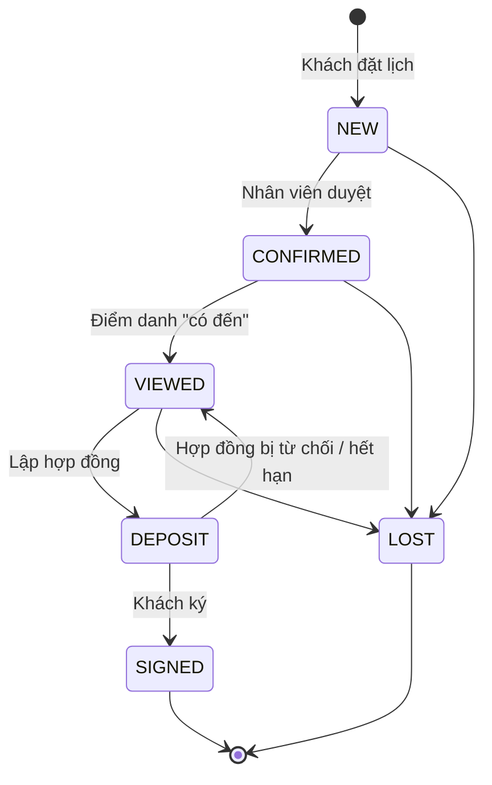

# Vai trò, quyền và trạng thái

File này là luật chung của hệ thống: ai được làm gì, và mỗi đối tượng (lead, buổi xem, căn nhà, hợp đồng) có những trạng thái nào, chuyển qua lại ra sao. Quy tắc của từng chặng nằm ở:

- [dat-lich-den-dat-coc.md](dat-lich-den-dat-coc.md): đặt lịch, duyệt, xem nhà và điểm danh, đặt cọc và ký.
- [cham-soc-va-marketing.md](cham-soc-va-marketing.md): sau buổi xem, nuôi khách, điểm tương tác, báo cáo.

Tài liệu luồng trong `docs/luong/` chỉ link về đây, không chép lại quy tắc. Nếu code chạy khác với file này, báo trong nhóm để sửa một trong hai, không để lệch.

Cập nhật lần cuối: 4/11/2026.

## 1. Hệ thống mô phỏng gì

Một văn phòng môi giới bất động sản nhận bán nhà cho chủ nhà hoặc chủ đầu tư và tìm người mua. Khách xem danh sách nhà, đặt lịch xem, đi xem, rồi đặt cọc nếu muốn mua. AI và n8n làm phần lặp lại (chấm điểm khách, soạn thư, nhắc việc, soạn hợp đồng, tổng hợp số liệu); con người duyệt ở các bước quan trọng.

Đội sale dùng chung một danh sách khách. Khách không được giao cho riêng một sale; ai thao tác thì hệ thống ghi tên người đó vào nhật ký của khách.

## 2. Phạm vi

**Có làm:** toàn bộ vòng đời của khách, từ lúc đăng ký xem nhà đến lúc ký hợp đồng đặt cọc, quản lý xác nhận đã nhận tiền cọc và đánh dấu căn đã bán. Cộng với chăm sóc khách sau buổi xem và báo cáo kinh doanh hằng tuần.

**Không làm** (ghi vào mục hướng phát triển của báo cáo):

| Việc | Lý do |
|---|---|
| Hoa hồng, lương của sale | Việc của kế toán, nhân sự; không thuộc đề tài |
| Chia khách cho từng sale, thu hồi khách khi sale chậm | Đội dùng chung danh sách (mục 1) |
| Thanh toán, hợp đồng mua bán công chứng, sang tên | Hệ thống dừng ở hợp đồng đặt cọc và "đã bán" |
| Khách tự chọn giờ mới khi đổi lịch | Khách chỉ gửi yêu cầu, nhân viên chọn giờ |
| Gộp nhiều lần đặt của cùng một khách thành một hồ sơ | Các lần đặt được nối với nhau qua email (mục 4.1) |

## 3. Vai trò và quyền

| Vai | Là ai | Đăng nhập |
|---|---|---|
| Khách | Người muốn mua nhà | Không cần tài khoản. Thao tác qua web khách, Telegram, ..., hoặc link có mã riêng gửi qua email, ... |
| Sale (`SALE`) | Nhân viên bán hàng | Tài khoản web admin, app, ... |
| Quản lý (`MANAGER`) | Trưởng văn phòng | Tài khoản web admin, app, ... |
| Tự động | n8n và AI | Gọi API backend bằng header `X-Webhook-Secret`. Mọi thao tác ghi dữ liệu đều đi qua backend |

| Việc | Khách | Sale | Quản lý | Tự động |
|---|---|---|---|---|
| Xem nhà, đặt lịch xem qua web, Telegram, ... | ✅ | | | Trợ lý AI trên Telegram, ... đặt lịch hộ khách |
| Huỷ lịch hoặc xin đổi lịch bằng link quản lý lịch | ✅ | | | |
| Gửi cảm nhận sau buổi xem (link `/cam-nhan/<mã>`) | ✅ | | | Hỏi cảm nhận, AI phân tích |
| Ký hợp đồng đặt cọc (link `/ky/<mã>`) | ✅ | | | Gửi link, nhắc ký |
| Duyệt lịch, đổi giờ xem | | ✅ | ✅ | Nhắc khi chưa duyệt |
| Điểm danh buổi xem (có đến, không đến) | | ✅ | ✅ | Nhắc khi chưa điểm danh |
| Đánh dấu "Không mua" kèm lý do | | ✅ | ✅ | Đóng lead quá hạn không xử lý |
| Lập hợp đồng đặt cọc | | ✅ | ✅ | AI soạn và rà nội dung |
| Duyệt hoặc từ chối hợp đồng | | | ✅ | |
| Xác nhận "Đã nhận tiền cọc", đánh dấu căn "Đã bán" | | | ✅ | |
| Thêm, sửa, ẩn, xoá căn nhà | | | ✅ | |
| Xem báo cáo tuần, bấm tạo báo cáo ngay | | | ✅ | Lập báo cáo mỗi thứ Hai |
| Tạo tài khoản nhân viên | | | ✅ | |
| Xem danh sách khách, lịch xem, hợp đồng, số liệu tổng quan | | ✅ | ✅ | |

### Khách nhận thông tin qua đâu

Khách không có tài khoản. Hệ thống gửi cho khách qua email, ..., mỗi việc cần khách làm đi kèm một **link riêng có mã bí mật**: ai có link thì mở được đúng một việc của đúng một khách.

Thư gửi khách là thư tự động: khách thao tác bằng link, không bằng cách trả lời thư. Thư khách trả lời vào hộp thư chung của văn phòng, hệ thống không đọc.

| Lúc nào | Khách nhận | Link riêng |
|---|---|---|
| Vừa đặt lịch | Thư báo đã nhận yêu cầu (nội dung theo mức khách) | Không có |
| Nhân viên duyệt | Thư chốt lịch: căn, địa chỉ, giờ xem | `/lich/<mã>`: xem lịch, huỷ, xin đổi lịch |
| Nhân viên đổi giờ | Thư báo giờ mới | `/lich/<mã>` (cùng link) |
| Trong 24 giờ trước giờ hẹn | Thư nhắc lịch | |
| Đã qua giờ hẹn 2 giờ, khách có đến | Thư hỏi cảm nhận | `/cam-nhan/<mã>`: chấm sao, nhận xét, chọn muốn cọc / xem căn khác / chưa có nhu cầu |
| Quản lý duyệt hợp đồng | Thư mời ký | `/ky/<mã>`: đọc và ký hợp đồng |
| 48 giờ chưa ký | Thư nhắc ký | `/ky/<mã>` (cùng link) |
| Ký xong | Thư xác nhận đã ký | `/hop-dong/<mã>`: xem lại, in hoặc lưu PDF hợp đồng |

Khách cũng chat với trợ lý AI trên Telegram, ... để tìm nhà, hỏi đáp, đặt lịch và tra các lịch đã đặt. Muốn tra lịch, khách phải nhập đúng cả email và số điện thoại đã dùng khi đặt, để người khác không xem được lịch của khách.

Vì sao không làm đăng nhập cho khách:

- Khách xem nhà thường chỉ đặt một vài lần; bắt tạo tài khoản dễ làm khách bỏ ngang.
- Mỗi link chỉ làm được một việc và có điều kiện riêng (link quản lý lịch hết dùng được khi tới giờ hẹn, link ký hết hạn sau 7 ngày), nên lộ link cũng chỉ ảnh hưởng một việc.
- Khách mất email thì liên hệ nhân viên; nhân viên làm thay được mọi việc trên web admin (đổi giờ, huỷ, lập hợp đồng, ...).

## 4. Trạng thái

### 4.1. Lead (khách đăng ký xem nhà)

Mỗi lần khách đặt lịch tạo ra **một lead gắn với một buổi xem một căn**. Khách đặt lịch xem căn khác là một lead mới. Trang chi tiết lead hiện mục "Các lần đặt khác" gồm các lead có cùng email.

| Mã | Nhãn trên web | Nghĩa |
|---|---|---|
| `NEW` | Mới | Vừa đặt lịch, chờ nhân viên duyệt |
| `CONFIRMED` | Đã chốt lịch | Nhân viên đã duyệt, chờ đến giờ xem |
| `VIEWED` | Đã xem nhà | Khách đã đến xem (đã điểm danh) |
| `DEPOSIT` | Đang làm hợp đồng cọc | Đã lập hợp đồng, chờ duyệt hoặc chờ khách ký |
| `SIGNED` | Đã ký hợp đồng cọc | Khách đã ký. Trạng thái cuối |
| `LOST` | Không mua | Khách không mua nữa, luôn kèm lý do. Trạng thái cuối |

| Từ → Đến | Ai, khi nào |
|---|---|
| (chưa có) → `NEW` | Khách đặt lịch qua web, Telegram, ... |
| `NEW` → `CONFIRMED` | Nhân viên duyệt bằng nút trong email, Telegram, ... hoặc trên web admin. Không duyệt được khi AI chưa chấm điểm xong |
| `CONFIRMED` → `LOST` (`CUSTOMER_CANCELLED`) | Khách tự huỷ bằng link quản lý lịch (link gửi kèm thư chốt lịch, nên khách chỉ có link sau khi được duyệt) |
| `NEW` → `LOST` (`EXPIRED`) | Tự động: giờ hẹn đã qua mà chưa ai duyệt *(có từ FE-30)* |
| `CONFIRMED` → `VIEWED` | Nhân viên điểm danh "có đến" |
| `CONFIRMED` → `LOST` (`NO_SHOW`) | Nhân viên điểm danh "không đến" và chọn đóng lead |
| `CONFIRMED` → `CONFIRMED` (giờ mới) | Nhân viên đổi giờ, hoặc điểm danh "không đến" và chọn hẹn lại |
| `VIEWED` → `DEPOSIT` | Nhân viên lập hợp đồng đặt cọc |
| `DEPOSIT` → `VIEWED` | Hợp đồng bị quản lý từ chối hoặc hết hạn |
| `DEPOSIT` → `SIGNED` | Khách ký hợp đồng |
| `NEW`, `CONFIRMED`, `VIEWED` → `LOST` | Nhân viên bấm "Không mua" kèm lý do. Buổi xem còn chờ thì chuyển "Đã huỷ" |

Khách đang `DEPOSIT` **không** bấm "Không mua" được: quản lý phải từ chối hợp đồng trước, lead tự về `VIEWED`, căn tự về "Đang bán", rồi mới đóng lead nếu khách thật sự không mua. Trên trang chi tiết lead, nút "Không mua" ẩn đi và thay bằng dòng hướng dẫn này. Nếu vẫn gọi API (web admin hoặc n8n), backend trả `400`: "Khách đang đặt cọc, chưa chuyển sang "Không mua" được. Quản lý từ chối hợp đồng trước, khách sẽ về "Đã xem nhà"." *(từ BF-06)*. `SIGNED` và `LOST` không đổi được nữa.

**Lý do "Không mua"**

| Mã | Nhãn | Khi nào |
|---|---|---|
| `NO_SHOW` | Khách không đến xem | Điểm danh "không đến" và đóng lead |
| `NOT_INTERESTED` | Không còn nhu cầu | Nhân viên chọn sau khi gọi khách |
| `CUSTOMER_CANCELLED` | Khách tự huỷ lịch | Khách huỷ bằng link quản lý lịch |
| `EXPIRED` | Quá hạn không xử lý | Tự động, giờ hẹn qua mà chưa duyệt *(có từ FE-30)* |
| `OTHER` | Lý do khác | Mặc định khi nhân viên không chọn lý do |

Khách mất trước khi có lý do (dữ liệu cũ) để trống.

**Mức khách** do AI chấm khi khách đặt lịch, theo điểm 0–100: `HOT` từ 70 điểm, `WARM` từ 40 đến 69, `COLD` dưới 40. Ngân sách rõ và nhu cầu cụ thể thì điểm cao; ngân sách từ 90% giá căn trở lên được cộng mạnh, dưới 50% bị trừ mạnh. Mức quyết định nội dung thư gửi khách và cách chăm sóc sau buổi xem.

**Trạng thái xử lý AI** của lead: `PENDING` (đang chấm), `COMPLETED` (chấm xong), `FAILED` (luồng tự động lỗi giữa chừng; nhân viên vẫn xử lý tay được).

### 4.2. Buổi xem

Mỗi lead có đúng một buổi xem. Đổi giờ thì sửa giờ trên buổi xem đó, giờ cũ được ghi vào nhật ký.

| Mã | Nhãn | Từ đâu |
|---|---|---|
| `NEW` | Chờ xem | Khi khách đặt lịch; vẫn `NEW` khi đổi giờ |
| `ATTENDED` | Khách đã đến | Điểm danh "có đến" |
| `NO_SHOW` | Khách không đến | Điểm danh "không đến" và đóng lead |
| `CANCELLED` | Đã huỷ | Khách huỷ bằng link, hoặc nhân viên bấm "Không mua" khi buổi xem còn chờ |

Dữ liệu trước FE-19 có buổi xem để `NEW` dù khách đã xem, vì lúc đó chưa có điểm danh.

### 4.3. Căn nhà

| Mã | Nhãn | Hiện cho khách | Nhận đặt lịch |
|---|---|---|---|
| `AVAILABLE` | Đang bán | Có | Có |
| `RESERVED` | Đang giữ cọc | Có | Không |
| `SOLD` | Đã bán | Không | Không |
| `HIDDEN` | Đã ẩn | Không | Không |

| Từ → Đến | Ai, khi nào |
|---|---|
| (chưa có) → `AVAILABLE` hoặc `HIDDEN` | Quản lý thêm căn |
| `AVAILABLE` ↔ `HIDDEN` | Quản lý ẩn hoặc hiện lại |
| `AVAILABLE` → `RESERVED` | Tự động khi nhân viên lập hợp đồng cho căn |
| `RESERVED` → `AVAILABLE` | Tự động khi hợp đồng bị từ chối hoặc hết hạn và căn không còn hợp đồng nào khác |
| `RESERVED` → `SOLD` | Quản lý, chỉ khi hợp đồng của căn đã ký |

Căn đang có hợp đồng còn hiệu lực thì quản lý không đổi trạng thái được (trừ chuyển sang "Đã bán" như trên).

### 4.4. Hợp đồng đặt cọc

Mỗi căn và mỗi khách chỉ có tối đa **một hợp đồng còn hiệu lực** (đang soạn, chờ duyệt, đã gửi hoặc đã ký).

| Mã | Nhãn | Nghĩa |
|---|---|---|
| `DRAFTING` | Đang soạn | Nhân viên vừa lập, AI đang soạn và rà nội dung |
| `PENDING_APPROVAL` | Chờ duyệt | Soạn xong, chờ quản lý duyệt |
| `SENT` | Đã gửi khách ký | Quản lý đã duyệt, khách nhận link ký |
| `SIGNED` | Đã ký | Khách đã ký. Sau đó quản lý xác nhận "Đã nhận tiền cọc" |
| `REJECTED` | Bị từ chối | Quản lý từ chối, kèm lý do |
| `EXPIRED` | Hết hạn | Quản lý không duyệt kịp, hoặc khách không ký kịp |

Thời hạn duyệt, ký và nhắc ký: xem [dat-lich-den-dat-coc.md](dat-lich-den-dat-coc.md).

### 4.5. Cảm nhận của khách

Khách gửi cảm nhận một lần sau buổi xem: số sao, nhận xét và mong muốn tiếp theo.

| Mã | Khách chọn | Hệ thống làm |
|---|---|---|
| `DEPOSIT` | Muốn đặt cọc | Hiện việc "khách muốn đặt cọc" cho nhân viên |
| `OTHER` | Muốn xem căn khác | Nhân viên gợi ý căn phù hợp hơn |
| `NONE` | Chưa có nhu cầu nữa | Hiện việc cho nhân viên gọi lại; **không** tự đóng lead |

## 5. Nhật ký sự kiện

Mỗi lần trạng thái đổi hoặc hệ thống làm một việc trên một khách, backend ghi một dòng vào bảng `lead_events`. Nhật ký dùng để: hiện dòng thời gian trên trang chi tiết lead, chống gửi trùng (luồng tự động kiểm tra đã làm việc đó chưa), tính báo cáo và tra lỗi. Thao tác của nhân viên ghi kèm tên người làm.

| Nhóm | Sự kiện |
|---|---|
| Đặt lịch, duyệt | AI chấm điểm · Nhân viên duyệt lịch · Nhân viên yêu cầu đổi giờ · Quá 24 giờ chưa duyệt · Đã nhắc nhân viên duyệt lịch · Đổi giờ xem nhà · Khách xin đổi lịch · Lịch xem bị huỷ |
| Buổi xem | Đã nhắc lịch · Đã nhắc xác nhận buổi xem · Báo quản lý: buổi xem chưa xác nhận · Khách không đến xem |
| Sau buổi xem | Đã hỏi cảm nhận · Khách gửi cảm nhận · AI phân tích cảm nhận · Đã nhắc khách WARM · Bắt đầu nuôi khách WARM |
| Hợp đồng, căn | Tạo hợp đồng · Hợp đồng soạn xong · Hợp đồng gửi khách ký · Khách ký hợp đồng · Hợp đồng bị từ chối · Hợp đồng hết hạn · Đã nhận tiền cọc · Căn chuyển sang giữ cọc · Căn đã bán |
| Marketing | Đồng bộ sang Mautic · Điểm Mautic thay đổi |
| Chung | Đổi trạng thái · Follow-up bị lỗi |

Danh sách mã đầy đủ: `LEAD_EVENT_TYPES` trong `backend/src/leads/lead.constants.ts`.

## 6. Thuật ngữ

| Từ | Nghĩa |
|---|---|
| Lead | Một lần khách đăng ký xem một căn |
| Duyệt lịch | Nhân viên xác nhận giờ xem với khách, lead chuyển "Đã chốt lịch" |
| Điểm danh | Nhân viên ghi nhận khách có đến buổi xem hay không |
| Giữ cọc | Căn đã có hợp đồng đặt cọc còn hiệu lực, tạm ngừng nhận lịch xem |
| Link quản lý lịch | Link riêng trong thư xác nhận (`/lich/<mã>`) để khách huỷ hoặc xin đổi lịch |
| Nuôi khách | Gửi nội dung định kỳ cho khách chưa sẵn sàng mua, qua Mautic |
| Đồng ý nhận tin | Ô khách tick khi đặt lịch; không tick thì không gửi nội dung marketing (Nghị định 13/2023) |
