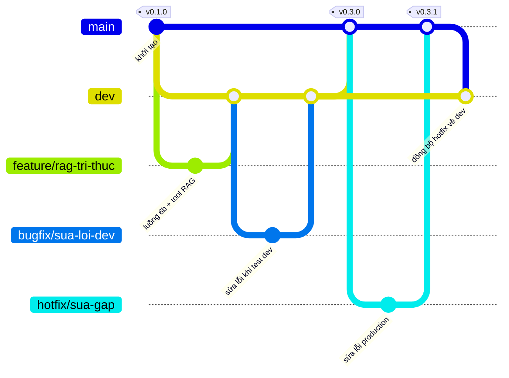

# Quy trình Git của nhóm

Áp dụng từ 2/11/2026. Mô hình git-flow rút gọn: `main` là bản đang chạy trên VPS, `dev` là nơi gom và test chức năng trước khi phát hành.

## 1. Sơ đồ nhánh



| Nhánh | Tạo từ | PR vào | Dùng khi | Cách merge trên GitHub |
|---|---|---|---|---|
| `main` | | | Bản đang chạy trên VPS. CI tự deploy mỗi khi có commit mới | |
| `dev` | `main` | | Gom các chức năng đã review, test chung trước khi phát hành | |
| `feature/<ten>` | `dev` | `dev` | Chức năng mới | Create a merge commit |
| `bugfix/<ten>` | `dev` | `dev` | Lỗi tìm thấy khi test trên `dev` | Create a merge commit |
| `hotfix/<ten>` | `main` | `main` | Lỗi đang xảy ra trên VPS, không chờ release được | Create a merge commit |
| Release | | `dev` → `main` | Phát hành một lô chức năng | **Create a merge commit** |
| Đồng bộ | | `main` → `dev` | Sau mỗi hotfix | **Create a merge commit** |

**Mọi PR đều chọn "Create a merge commit", không dùng Squash hay Rebase.** Lý do:

- Giữ nguyên từng commit với ngày giờ gốc của người làm, dùng làm bằng chứng thời gian làm việc.
- PR giữa `dev` và `main` mà squash sẽ tạo commit chỉ có ở một bên, lần release sau xung đột với chính nó.

Tên nhánh viết thường, không dấu, nối bằng gạch ngang: `feature/luong-6-homnay`, `bugfix/lich-xem-trung-gio`, `hotfix/web-404-chi-tiet-nha`. Nhánh tài liệu dùng `docs/<ten>`, nhánh CI hoặc cấu hình dùng `chore/<ten>`; cả hai đi vào `dev` như feature.

CI `Kiem tra PR` (`.github/workflows/pr-check.yml`) chạy cho mọi PR vào `dev` và `main`: chặn PR vào `main` không đến từ `dev` hoặc `hotfix/*`, chạy lint và build cho backend và web, chạy test backend (`npm test`, job riêng dùng Node 24), đọc thử toàn bộ JSON n8n. PR đỏ thì sửa xong mới merge.

## 2. Làm một task

**Bắt đầu**

```bash
git switch dev
git pull
git switch -c feature/<ten>
```

Mỗi nhánh một việc, làm trong 1–3 ngày. Việc lớn thì chia nhiều PR.

**Trong lúc làm**

- Commit nhỏ, message dạng `feat(l6): ...`, `fix(web): ...`, `docs: ...` (không dấu).
- Mỗi ngày kéo `dev` về để gặp xung đột sớm:

  ```bash
  git fetch origin
  git merge origin/dev
  ```

- Không để code chưa commit nằm lâu trong máy. Hết ngày thì commit (có thể ghi `wip:`) và push nhánh lên.

**Tự test trước khi mở PR** (người viết làm)

- Backend, web: `npm run lint` và `npm run build` trong thư mục đã sửa. Backend chạy thêm `npm test`.
- Test backend cần **Node 24.9 trở lên** (kiểm tra: `node -v`; cài bản LTS mới ở nodejs.org). NestJS 12 là ESM, Jest 30 chỉ nạp được khi Node đủ mới và chạy ở chế độ `--experimental-vm-modules` (đã có sẵn trong `npm test`). Node cũ hơn thì `npm test` dừng và báo phiên bản; gọi thẳng `npx jest` sẽ báo lỗi "Must use import to load ES Module". Chạy backend và build không cần Node 24, image Docker vẫn là Node 20. Test mới dựng service với repository giả (xem `src/leads/leads.service.spec.ts`, `src/followups/followups.service.spec.ts`), không dùng `Test.createTestingModule` vì cần đủ provider và database.
- Chạy stack ở máy mình, build lại service vừa sửa: `docker compose -p realestate-ai-agent up -d --build --no-deps <service>`.
- n8n: import JSON vào n8n local, chạy ít nhất một ca end-to-end thật, export JSON lại vào repo. Mỗi người chỉ sửa file luồng của mình.

**Mở PR vào `dev`**

Điền đủ template: làm gì, **cách test**, **bước deploy làm tay** (SQL, import n8n, biến `.env` mới), ảnh chụp nếu sửa giao diện.

**Review và merge**

| | Task của Hoàng | Task của Hậu |
|---|---|---|
| Review, chạy lại phần "Cách test" trên máy mình | Hậu | Hoàng |
| Approve | Hậu | Hoàng |
| Create a merge commit vào `dev`, xoá nhánh | Hoàng | Hậu |

Review trong vòng 1 ngày. Nếu người review bận quá 1 ngày, người viết được tự merge vào `dev` sau khi CI xanh và ghi rõ trong PR là chưa ai test lại.

## 3. Phát hành (`dev` → `main`)

Làm khi `dev` có một lô chức năng đã test, ít nhất mỗi tuần một lần, và trước các mốc 22/11, 3/12.

1. **Test chung trên `dev`.** Cả hai kéo `dev` về, chạy trọn hành trình khách ở máy mình: đặt lịch trên web và Telegram → sale duyệt → khách nhận email → đánh dấu đã xem → cảm nhận → làm hợp đồng cọc → ký. Lỗi tìm thấy sửa bằng `bugfix/*` vào `dev`.
2. **Mở PR `dev` → `main`**, tên `Release vX.Y.Z`. Phần "Bước deploy làm tay" gom từ các PR trong lô.
3. Người kia approve, **Create a merge commit**. CI deploy lên VPS.
4. Hoàng làm các bước deploy tay trên VPS (chạy SQL, `import:workflow` → `publish:workflow` → restart n8n).
5. **Smoke test trên VPS:** mở trang khách và một trang chi tiết nhà; đặt một lịch test bằng email `nhadn2457+test...@gmail.com`; xem execution của luồng 1 thành công và email đến; đăng nhập trang admin.
6. Gắn tag và đẩy lên:

   ```bash
   git switch main
   git pull
   git tag -a vX.Y.Z -m "Release vX.Y.Z: <tóm tắt>"
   git push origin vX.Y.Z
   ```

## 4. Sửa lỗi gấp trên VPS (hotfix)

```bash
git switch main
git pull
git switch -c hotfix/<ten>
```

Sửa, test ở máy mình, mở PR vào `main`. Merge xong: deploy tay nếu cần, smoke test, gắn tag tăng số cuối (`v0.3.0` → `v0.3.1`). Sau đó **mở PR `main` → `dev`** ("Đồng bộ hotfix vX.Y.Z về dev"), Create a merge commit, để `dev` không mất bản sửa.

## 5. Phiên bản

| Tag | Commit | Ý nghĩa |
|---|---|---|
| `v0.1.0` | `55d99d9` | Bản demo 24/10 |
| `v0.2.0` | `603ecd5` | Bản chạy trên VPS ngày 2/11, trước khi đổi quy trình |
| `v0.3.0` | | Release kế tiếp (RAG, close-gaps) |
| `v1.0.0` | | Web hoàn thành 22/11 |
| `v1.1.0` | | Bản nộp 5/12 (khoá code 3/12) |

Số giữa tăng khi release chức năng mới, số cuối tăng khi hotfix. Cần quay lại bản cũ thì `git switch --detach vX.Y.Z`.

## 6. Tránh xung đột

- `.env` không bao giờ commit. Thêm biến mới thì ghi vào `.env.example` và mục "Bước deploy làm tay" của PR.
- File chỉ có trên server (`docker-compose.server.yml`, `.env`) không đưa vào repo.
- File dùng chung (`lead.entity.ts`, `lead.constants.ts`, `docker-compose*.yml`, file JSON n8n) theo mục 8 của `docs/ke-hoach-tich-hop.md`: mỗi người sửa phần của mình, cần sửa phần của người kia thì nhắn trước.
- Không push thẳng vào `dev` hay `main`, không `push --force` lên hai nhánh này.

## 7. Cài đặt trên GitHub

- **Default branch = `dev`** để PR mới tự chọn base `dev`. Trước khi nộp 5/12 đổi lại `main` (nhánh chấm điểm).
- **Bảo vệ `main` và `dev`** (Settings → Branches hoặc Rulesets): bắt buộc qua PR, bắt buộc CI `Kiem tra PR` xanh, cấm force push và xoá nhánh. Repo private trên gói GitHub Free không có tính năng này; nếu có GitHub Pro (ví dụ qua GitHub Student Developer Pack) thì bật, không thì cả nhóm tự giữ quy ước ở mục 6.
- Bật "Automatically delete head branches" để nhánh tự xoá sau khi merge.

## 8. Chuyển cả dự án sang quy trình này (2/11/2026, làm một lần)

Chạy các lệnh dưới trong Git Bash, tại thư mục repo.

**Bước A. Đồng bộ `dev` với `main`, giữ lịch sử `dev` cũ, gắn tag (Hoàng)**

Nhánh `dev` cũ (18/10) là một bản code song song đã bị `main` làm lại theo cách khác, nên không merge thường được (xung đột khoảng 70 file). Thay vào đó tạo một merge commit có hai cha (`dev` cũ và `main`) nhưng nội dung lấy nguyên theo `main`. Kết quả:

- Lịch sử `dev` giữ đủ các commit cũ với ngày gốc 17–18/10, cộng toàn bộ commit của `main`.
- Nội dung `dev` giống hệt `main`, nên các PR và release sau không xung đột.
- `dev` cũ là tổ tiên của commit mới, nên push là fast-forward, không cần `--force`.

```bash
git fetch origin
C=$(git commit-tree "origin/main^{tree}" -p origin/dev -p origin/main -m "merge: dong bo dev voi main, giu lich su dev cu")
git diff --stat origin/main $C          # phải rỗng
git push origin $C:refs/heads/dev
git tag -a v0.1.0 55d99d9 -m "Ban demo 24/10"
git tag -a v0.2.0 603ecd5 -m "Ban dang chay tren VPS 2/11"
git push origin v0.1.0 v0.2.0
```

Máy nào đang ở nhánh `dev` cũ (cả Hoàng và Hậu): `git switch dev`, `git pull` (fast-forward).

App Expo cũ vẫn nằm trong lịch sử `dev` (commit `6a64517`). Tới giai đoạn làm app: tạo `feature/app-expo` từ `dev` rồi `git checkout 6a64517 -- app`.

**Bước B. Đưa mọi việc đang làm vào luồng mới**

| Nhánh / chỗ làm | Tình trạng ngày 2/11 | Việc cần làm | Ai |
|---|---|---|---|
| `chore/quy-trinh-git` | File này, CI `Kiem tra PR`, PR template | Push, PR vào `dev` (PR đầu tiên theo quy trình mới) | Hoàng mở, Hậu duyệt |
| `feature/rag-tri-thuc` | Đã push, tạo từ `main` (giống `dev` mới) | PR vào `dev` | Hoàng mở, Hậu duyệt |
| Worktree close-gaps (`claude/property-viewing-status-update-ff17cc`) | Khoảng 48 file chưa commit, xong 55/62 việc | Commit lên `feature/close-booking-gaps`, PR vào `dev` | Hoàng mở, Hậu duyệt |
| `docs/luong-hoang` | Swimlane luồng 1, 1b, 3, Error (19/10). Gộp vào `dev` không xung đột | `git merge origin/dev`, PR vào `dev` | Hoàng |
| `docs/api-contract-hoang` | Xung đột `docs/api-contract.md` | Gộp nội dung vào việc 8.1 của close-gaps (cũng sửa file này), rồi lưu tag và xoá nhánh | Hoàng |
| `docs/phoi-hop` | Quy tắc Git cũ ("làm trên main"), đã được file này thay thế | Lưu tag và xoá nhánh | Hoàng |
| `fix/n8n-luong-2-switch-fallback` và 31 nhánh khác đã merge vào `main` | Không còn dùng | Xoá trên GitHub | Hoàng |
| Thư mục repo chính (đang ở `feature/luong-2-va-mautic-web`, có 5 thay đổi chưa commit) | Nhánh này đã merge | Xem lại 5 thay đổi, giữ thì đưa vào nhánh mới từ `dev`, rồi `git switch dev` | Hoàng |
| Máy của Hậu | | `git switch dev`, `git pull`; từ nay mọi nhánh mới tạo từ `dev` | Hậu |

Lưu tag và xoá các nhánh cũ:

```bash
git tag archive/docs-phoi-hop origin/docs/phoi-hop
git tag archive/docs-api-contract-hoang origin/docs/api-contract-hoang
git push origin archive/docs-phoi-hop archive/docs-api-contract-hoang
git push origin --delete docs/phoi-hop docs/api-contract-hoang
git branch -r --merged origin/main | grep -v -E 'HEAD|/main$|/dev$' | sed 's#origin/##' | xargs -n1 git push origin --delete
```

**Bước C. Release đầu tiên**

Khi các PR ở bước B đã vào `dev` và test chung xong: PR `dev` → `main` tên `Release v0.3.0`, làm theo mục 3.

**Bước D. Cài đặt GitHub**

Làm theo mục 7.
